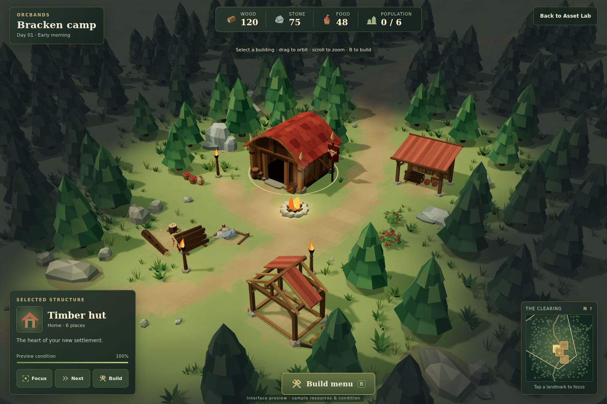
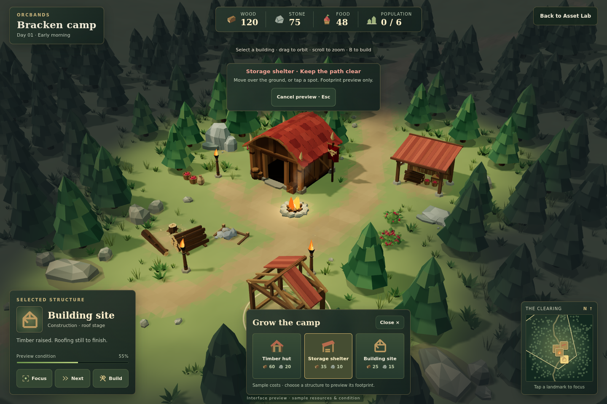

# Camp interface 01

First RTS interface preview from [inventory #30](https://github.com/cubitouch/Orcbands/issues/30), built around the actual grove and approved settlement art.

## Actual WebGL review

| Clear footprint | Blocked footprint |
|---|---|
|  |  |

[Selected construction site](reviews/camp-ui-01/camp-selected.png) · [Phone](reviews/camp-ui-01/camp-mobile.png) · [Phone build menu](reviews/camp-ui-01/camp-mobile-build.png)

Open **Camp interface** in the Asset Lab, or use `?scene=grove&hud=1`. **Back to Asset Lab** returns to ordinary inspection.

## Interface and behavior

- Wood, stone, food and population counters with original SVG icons. Values are explicitly sample supplies.
- A selection panel for the hut, storage shelter, building site and campfire, with descriptions, condition/progress bars, Focus and Next actions. Condition values are illustrative, including the unfinished building's 55% bar.
- Direct building selection in the 3D camp, with a terrain-following gold selection ring. Normal orbit/pan gestures remain available; dragging does not count as selection, and multi-touch does not trigger a stray click.
- A build menu with three authored structure icons and sample costs. The menu previews footprints only; it does not construct buildings or deduct supplies.
- Green/red footprint feedback against the actual paths, hut, other resources/buildings, fires, rocks, tree trunks and camp boundary. Move a pointer over the ground or tap a spot on mobile. Cancel clears the preview.
- A minimap drawn from all 244 real tree placements, the main path and camp landmarks, with a camera footprint outline. Landmark buttons select and focus the actual structure; clicking the map background pans within the existing camera bounds. Next provides a larger alternative to the small minimap landmark buttons.
- B opens/closes the build menu. Escape cancels a footprint first, then closes the menu. Cancelling restores keyboard focus to the originating build card. Controls have accessible names and focus outlines.

The full-screen preview uses an original dark woodland/gold palette and keeps UI panels around the scene edges. Portrait mode uses a closer elevated view and touch-oriented hints; it does not stretch the ordinary Asset Lab's wide forest framing across a tall screen.

## Integration and limits

The HUD is optional, with its own CSS and controller. The existing tree, hut, resources and grove inspection modes remain available. Exiting hides the HUD and its world overlays, removes the deep-link flag and restores the Asset Lab controls. No new dependencies, image assets or external fonts are added. Existing approved geometry and deterministic scene placement are unchanged.

`camp-ui-model.js` contains the catalog, illustrative values, actual landmark mapping, map transforms and placement checks. `camp-ui.js` contains the accessible DOM, native SVG artwork, input handling and two small Three.js overlays. A selected ring is 128 triangles; a footprint adds two. Both are hidden in ordinary Asset Lab modes. The minimap is DOM/SVG, with its camera outline updated at a bounded rate.

This is an interface prototype for review. It has no selectable characters, movement orders, construction simulation, storage accounting, save game or combat. The minimap shows the authored layout, rather than unexplored-territory memory or line-of-sight gameplay. Existing fire animation and static reveal presentation continue underneath. Touch behavior is exercised in Chromium; real phone GPU performance remains unmeasured.

## Verification

`node tools/validate-camp-ui.mjs` checks selection against actual landmarks, valid and blocked footprint locations for every catalog structure, path/tree/building/boundary exclusions, map-coordinate round trips, fixed sample supplies and an unchanged camp layout.

`ORCBANDS_LOCAL_THREE=1 node tools/smoke-camp-ui.mjs` exercises HUD deep links, a real world click on the hut, Next, minimap focus, actual pointer movement to valid and blocked footprints, unchanged supplies, keyboard cancel and focus return, mobile tap controls, mobile reload/exit, entering the HUD from the hut studio and returning to ordinary inspection, with no browser errors. It closes the desktop context before the mobile pass so two full-screen software renderers do not contend for the same CPU.

The ordinary WebGL regression and new UI smoke are both enabled in CI, with automatic screenshots preserved. The existing smoke server now serves CSS with its correct MIME type.
