# ART-ENV-01 — Environmental storytelling

The forest camp now sits among ten intentionally separated woodland pockets. The center, main route, hut approach and building access remain open. The approved trees, resources, structures, path geometry, fog, atmospheric shading and fire behavior are preserved.

## Added vocabulary and composition

- Five sunken, crooked dead logs with broken dark ends and asymmetric moss shelves. Their silhouette and subdued palette distinguish them from harvestable timber.
- Twenty-four short forked limbs, pushed outside the travel corridors.
- Nineteen moss-covered stones with some exposed grey facets.
- Eighteen small mushroom groups and twenty-four low leafy clumps.
- Two restrained chip groups outside the existing woodcutting station.
- Broad, noisy leaf-mould coloration baked into the existing terrain vertices. Route/work-area wear suppresses it; no circular decals or extra ground surfaces are introduced.

The pockets sit behind and beside the hut, around the shelter/construction woodland edges and on the clearing perimeter. Different densities and deliberate gaps avoid an even scatter. Seeded generation controls geometry, scale and orientation; placement reserves each prop's full horizontal extent.

## Browser / Unity bridge

`preview/forest-story.js` creates one merged vertex-colored mesh. Both `buildEnvironment` and `tools/generate-unity-environment.mjs` consume that geometry. Unity loads `woodland-story.bytes` with the existing vertex-color material; no new shaders, textures, lights or dependencies are introduced.

The bridge retains the existing X reflection, reversed triangle winding and linear-to-sRGB palette conversion. The new validator compares every exported vertex/color and reflected placement against the browser source. It also verifies real prop bounds, route/building clearance, outward upper-bark normals and reproducible layouts/geometry with alternate seeds.

## Cost

The initial art pass was simplified after measuring its rendered cost. Triangular branch/stem cross sections, five-sided mushroom caps and simpler stones retain the silhouettes at RTS distance.

| Measure | Before | Final candidate |
| --- | ---: | ---: |
| Overall Asset Lab draw calls | 64 | 65 |
| Overall Asset Lab triangles | 189,751 | 194,193 |
| Added prop triangles | — | 4,442 |
| New Unity stream | — | 319,828 bytes |
| Existing trees / plants / rocks | 244 / 1,533 / 30 | 244 / 1,533 / 30 |

The final triangle count is below the existing 195,000 scene limit. Draw calls remain below 66. One merged batch trades per-prop culling for a single material/batch; its bounded cost is appropriate for this small authored clearing. No frame-rate claim is made from software rendering.

## Validation

- All existing `tools/validate-*.mjs` checks passed locally for the initial pass; environment and full Unity parity checks passed again after simplification.
- Existing terrain/path vertex positions and all existing exported resource, rock, grass, patch, hearth and torch streams compare byte-for-byte against the base. Only 3,990 terrain vertex colors change.
- `tools/validate-forest-story.mjs`: deterministic placements/geometry; six prop families; full geometry within reserved clearances; alternate seeds; outward bark normals; every Unity position/color/placement checked.
- Matched real Asset Lab before/after captures include overall RTS, hut, shelter, construction, path transition, detail and 390px portrait viewport, with the same camera and fire time.
- Asset Lab real WebGL smoke and desktop/mobile camp HUD smoke passed on art commit `be36765147cb9dfa0b515a482d26f9f0d497cb35` ([run](https://github.com/cubitouch/Orcbands/actions/runs/39795383117)).
- Unity export/bridge, WebGL build, real Chromium boot, stationary-camera background stability, animated fire and fog/navigation regression checks passed ([run](https://github.com/cubitouch/Orcbands/actions/runs/39795383164)). Native macOS build was outside this WebGL task and skipped.

## Review captures

Before is main `2f9ae870adac451b7a99652e060fb60d4aa20ce6`. Candidate captures use art commit `be36765147cb9dfa0b515a482d26f9f0d497cb35`. [Capture provenance](reviews/art-env-01/provenance.json) records the build and smoke artifacts; [source hashes](reviews/art-env-01/source-sha256.json) identify the reviewed art source. The Unity after image is an unscaled crop of the CI default-camera screenshot; fire/smoke remains animated. These are real WebGL renders, not generated illustrations.

| View | Before | After |
| --- | --- | --- |
| Overall RTS | 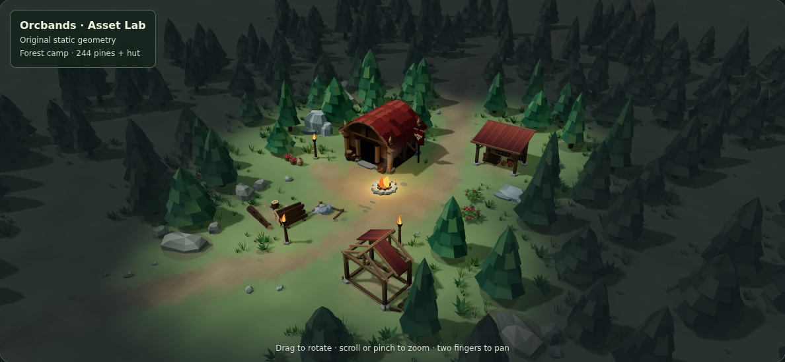 | 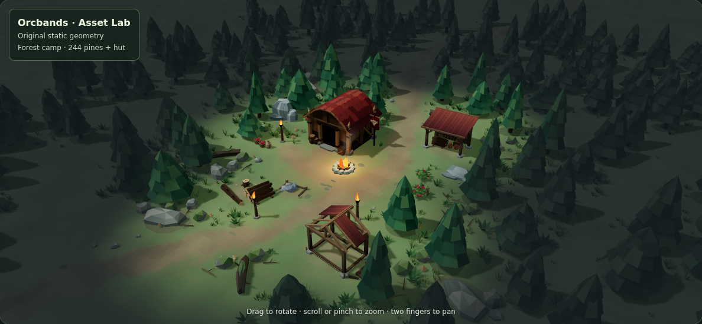 |
| Hut / woodland | 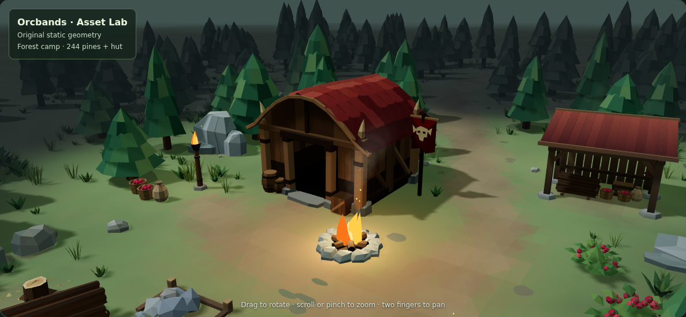 | 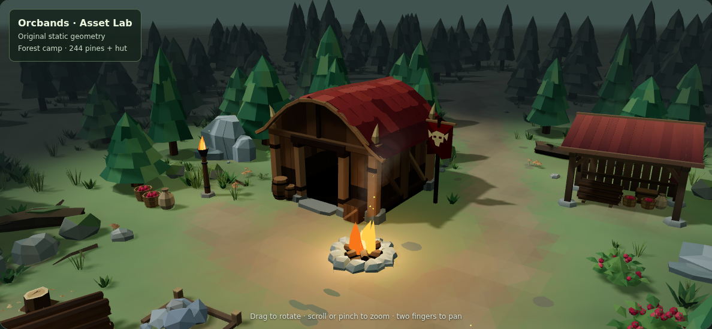 |
| Shelter access | 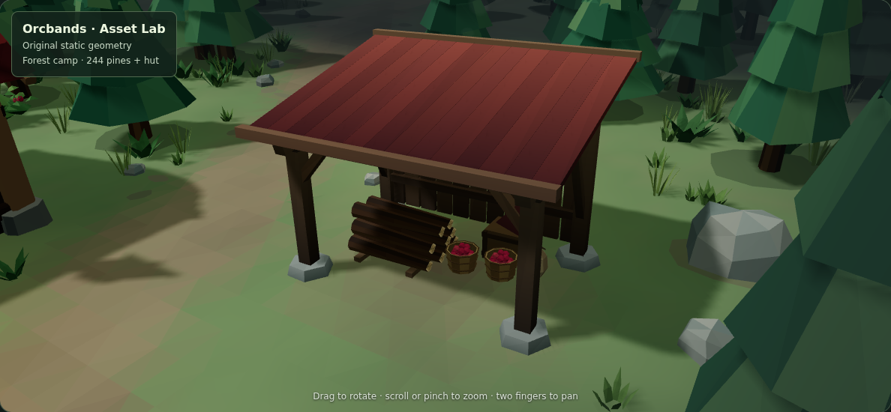 | 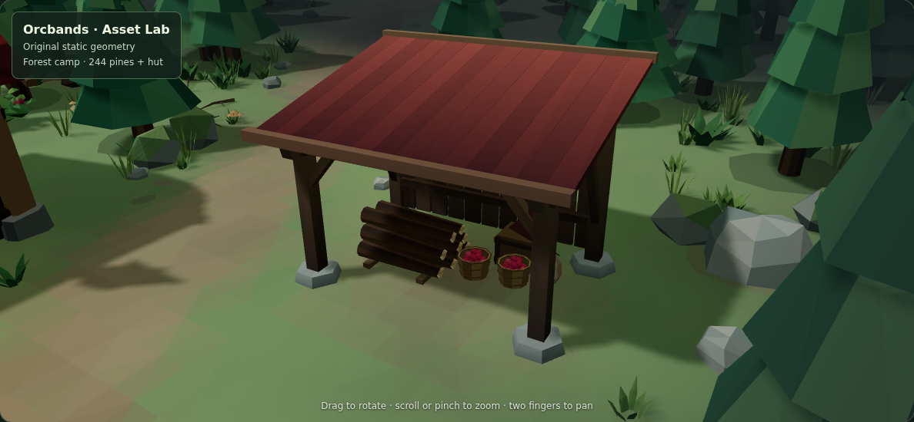 |
| Construction edge | 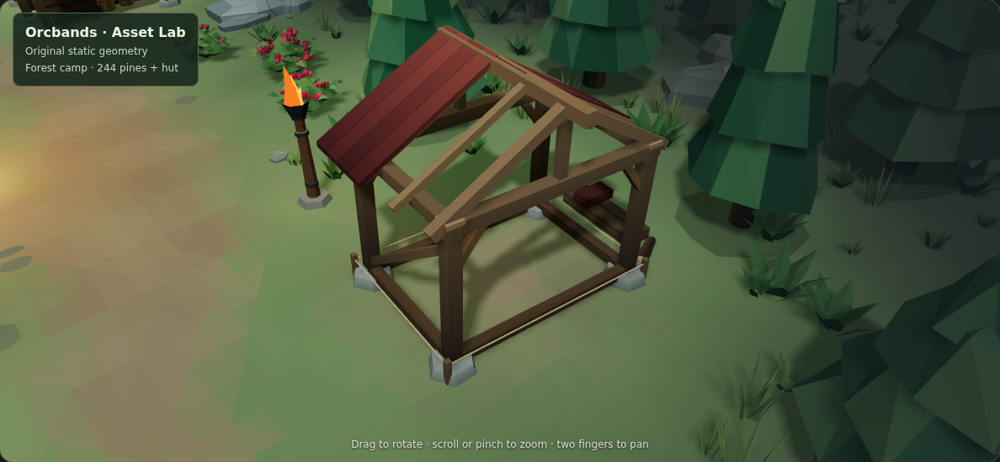 | 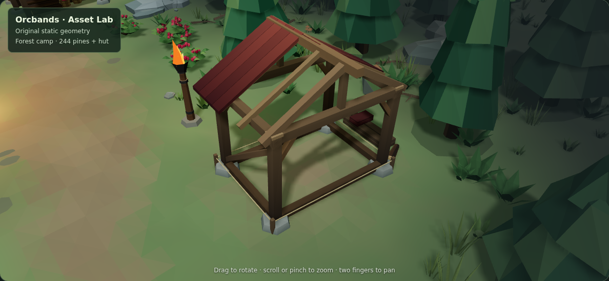 |
| Path transition | 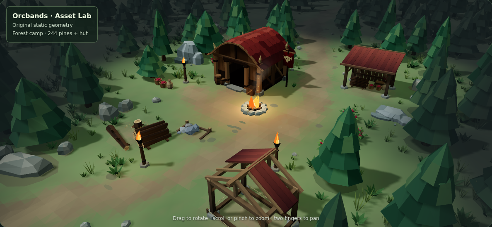 | 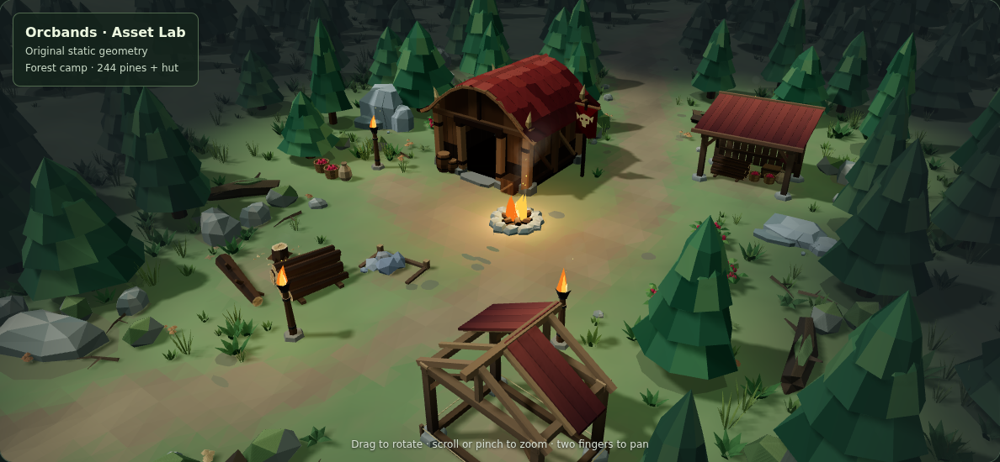 |
| Environmental detail | 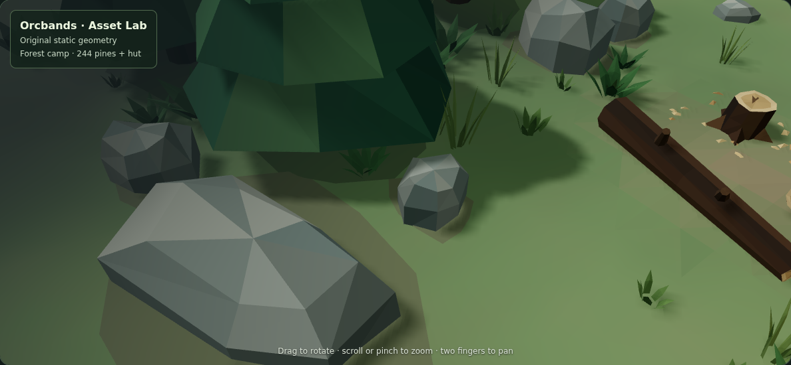 | 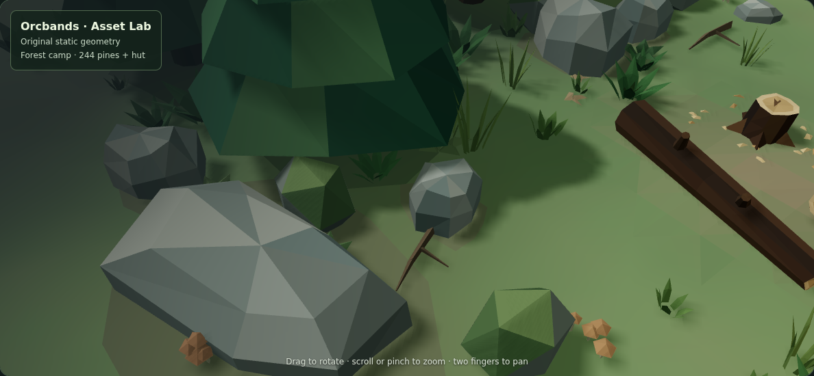 |
| Mobile | 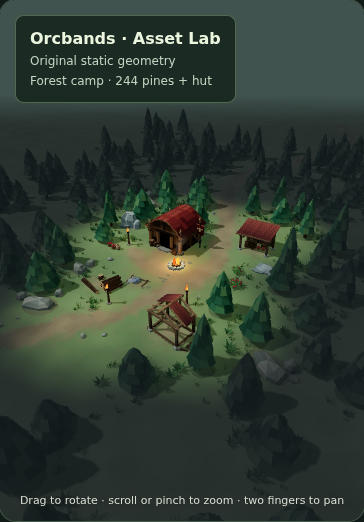 | 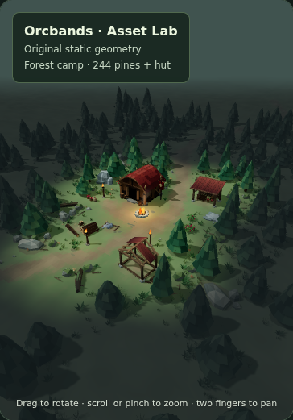 |
| Unity RTS | 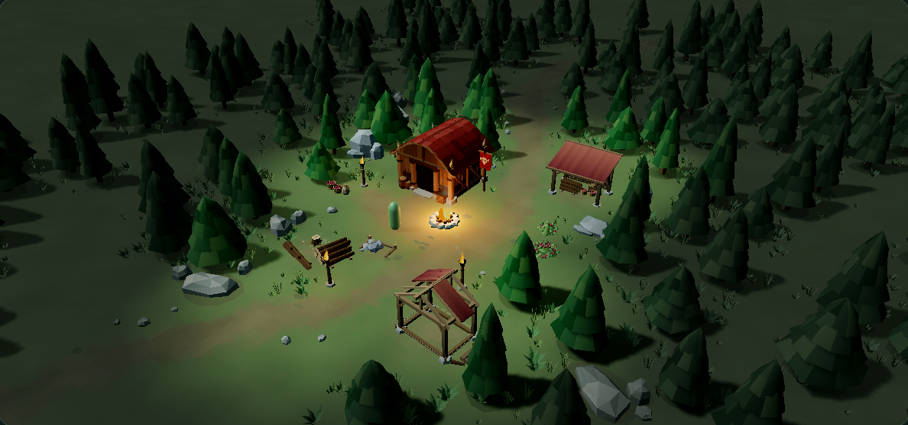 | 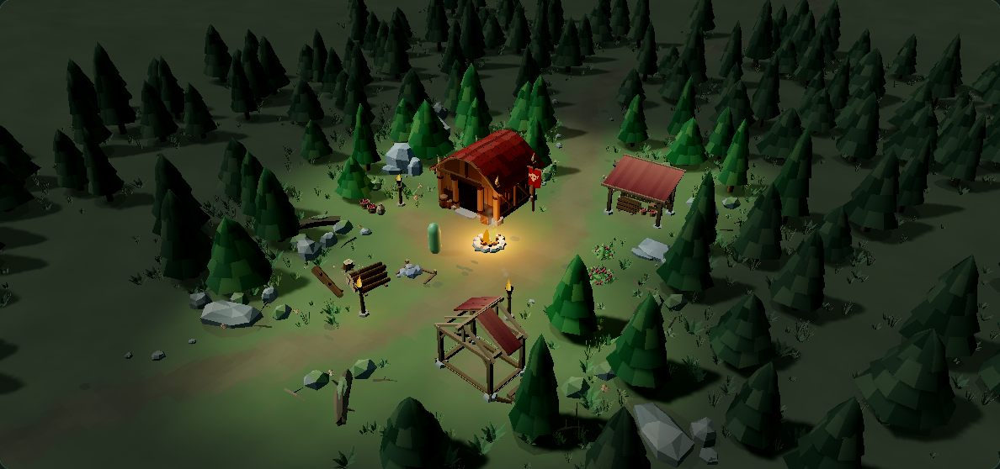 |

## Reproduce

```sh
npm install --no-save --ignore-scripts three@0.166.1 playwright@1.56.1
npx playwright install chromium
node tools/generate-unity-environment.mjs
node tools/validate-unity-environment.mjs
node tools/validate-forest-story.mjs
node tools/validate-environment.mjs
ORCBANDS_LOCAL_THREE=1 ORCBANDS_ESSENTIAL_CAPTURE=1 node tools/smoke-preview.mjs
node tools/capture-environment-story.mjs /path/to/base-checkout smoke-artifacts/story/before
node tools/capture-environment-story.mjs . smoke-artifacts/story/after
node tools/capture-unity-environment.mjs /path/to/unity-webgl-build smoke-artifacts/unity
```

The art capture harness freezes fire time and throttles its render loop on software GPUs; it does not alter the geometry, lighting or materials. The ordinary smoke tests exercise the application normally. Local SwiftShader smoke attempts encountered browser timeouts; the unmodified Asset Lab and camp HUD smoke tests passed in CI. The before/after comparison workflow preserves identical capture settings.

The PR remains draft and unmerged for visual approval. The mobile view keeps the camp readable; fine mushroom and branch details are intentionally secondary at that scale. This is environmental dressing, not interactive harvesting or pathfinding.
