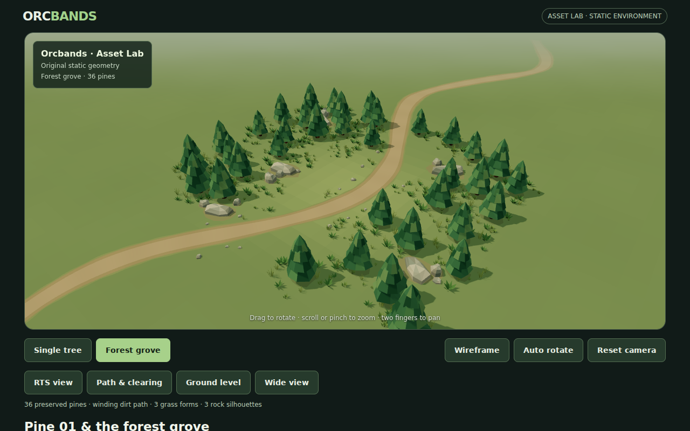
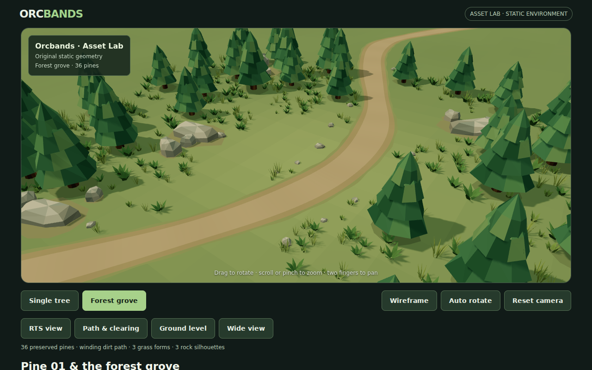
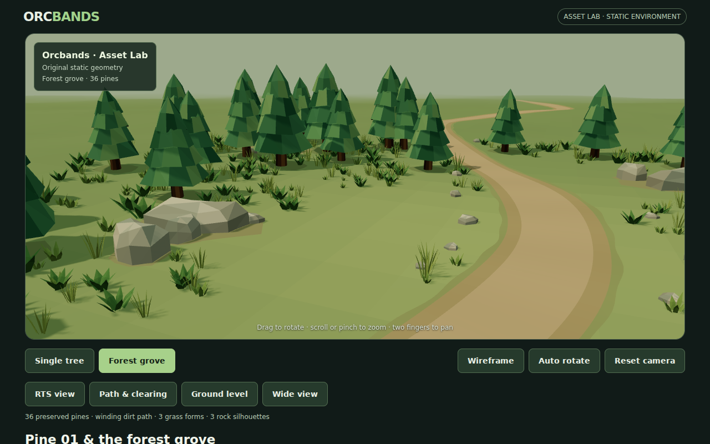
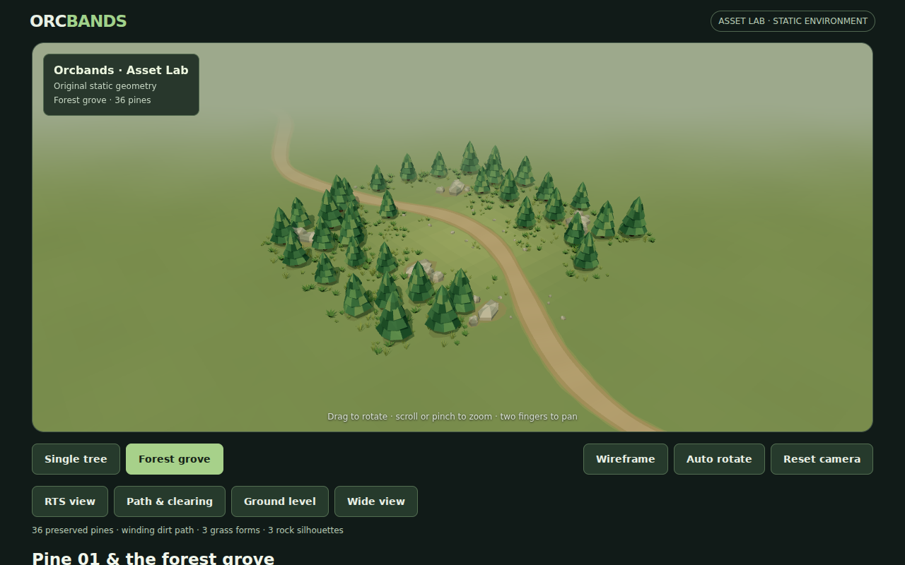
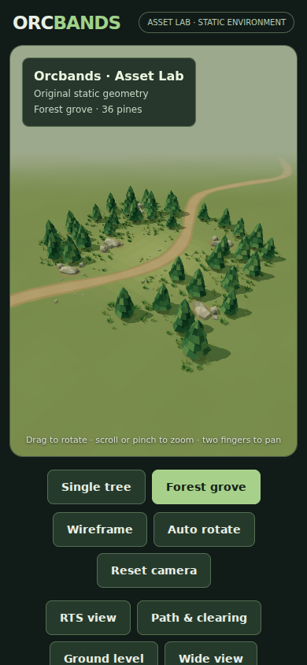

# ENV-02 — Forest grove

This records the initial ENV-02 composition. See [Path naturalism](path-naturalism.md) for the subsequent terrain-integrated path treatment and current measurements.

## Art direction and scope

This is a modest original low-poly woodland assembled in the Three.js Asset Lab. It is actual interactive WebGL geometry, with no rendered background illustration, textures, purchased assets, characters or gameplay. Pine 01's generator, OBJ and MTL remain unchanged and independently downloadable.

36 pines define several uneven woodland pockets around an approximately 12 × 10 metre open centre. The southern approach stays open so an elevated RTS camera can read the clearing. A winding 2.1–3 metre dirt corridor passes beside the clearing and continues beyond the woodland in both directions. The authored tree anchors establish the composition; seeded scale, yaw and ground-cover islands keep it from feeling like a grid.

A restrained olive floor connects the existing pine palette to warm, desaturated earth and gray/brown rocks. Larger outcrops anchor the woodland shoulders; smaller companions partly bury their bases. Ground cover is concentrated around trees and in a few meadow islands. The centre stays quiet for future units/buildings.

## Reusable definitions

- `preview/environment-layout.js`: pure deterministic placement, seed **2302**, ground height and continuous path functions. Edit the tree anchors to change composition. The path-clearance helper rejects props near the walkable route, including a silhouette margin. Positions use metres and +Y up.
- `preview/environment.js`: original geometry and reusable `createGrassGeometry(type)`, `createRockGeometry(type)` and `buildEnvironment(parent, sourceTree)` functions. The three grass forms are short pointed tufts, tall narrow blades and broad folded leaves. Rocks use three independently authored outlines and ring profiles: chipped wedge, irregular boulder and broad shelf. The broad forms are not enlarged copies of one polyhedron.
- Terrain: a broad 200 × 200 metre low-relief floor extends beyond the roughly 40 × 35 metre woodland. Smooth regional colors and subtle height variation avoid an isolated circular platform. Merged bare-floor patches sit under trees and rock clusters.
- Path: one continuous ribbon, with gently varying width, a worn middle, dusty shoulders and an irregular outer fringe. The same ground-height function anchors terrain, path and props. The visible route has no obstructing trees, rocks or grass.
- Rendering: pine material runs are consolidated into seven instanced batches without changing the source positions, normals or palette. The three plant forms and three rock forms also use instancing; ground patches are merged. Scales are uniform, with tree variation limited to 0.83–1.17.

Pine geometry is still the original 109 vertices / 144 polygon faces. The current seeded environment places **36 trees, 37 rocks and 607 grass clumps**. Props are reusable JavaScript geometry definitions; only Pine 01 currently has standalone OBJ/MTL downloads.

## Actual browser captures

These are screenshots from Chromium rendering the real scene with the same Three.js 0.166.1 package used by the viewer. No image generation or retouching is involved. Review buttons in Grove mode reproduce all four camera angles.

### Elevated RTS view



### Path and clearing



### Low angle: grass and rock silhouettes



### Wide composition from the opposite side



### Portrait framing



## Visual iteration

The first WebGL capture revealed an invisible, back-facing path and a checker pattern in the ground colors. The path winding was corrected and a mesh-normal regression check now covers it. Ground color changes use coherent regional variation. Further review caught abrupt path endpoints, which now continue out of sight, and excessively ragged shoulder strips, which now retain their order. Corridor checks moved a northern pine and excluded several roadside stones. Camera reset now drains pending damping so dragging and panning cannot pull it away after reset.

The final review inspected all four views and portrait framing, including a return to the original Single Tree. There are no visibly floating major props or blocked path sections in those views.

## Validation and reproduction

From the repository root, with Node.js 22+:

```sh
npm install --no-save --ignore-scripts playwright@1.56.1 three@0.166.1
npx playwright install --with-deps chromium
node tools/validate-environment.mjs
ORCBANDS_LOCAL_THREE=1 node tools/smoke-preview.mjs
```

`ORCBANDS_LOCAL_THREE=1` serves the exact pinned npm Three.js files into browser requests, avoiding CDN availability as a capture prerequisite. Omit it to test the production CDN requests. The deployed viewer still uses its existing CDN import map; no runtime dependency was added.

The structural check covers seeded layout, corridor and clearing bounds, all six prop forms, finite vertex data, upward-facing path normals and repeatable geometry/matrix/color hashes. The browser check covers scene switching and direct grove loading, wireframe, rotation, desktop orbit/zoom/pan/reset, portrait touch orbit/pinch/pan/reset and browser errors. Fresh PNGs and `metrics.json` are automatically uploaded by CI. Reference captures above are committed for immediate PR review.

Pine regeneration is still compared byte-for-byte in CI. It can also be checked locally:

```sh
node tools/generate-tree.mjs /tmp/orcbands-pine-check
cmp preview/assets/low-poly-pine-01.obj /tmp/orcbands-pine-check/low-poly-pine-01.obj
cmp preview/assets/low-poly-pine-01.mtl /tmp/orcbands-pine-check/low-poly-pine-01.mtl
```

The recorded desktop wide view and portrait reset each report **16 draw calls and 57,569 triangles** in `renderer.info.render`. These are scene complexity measurements from software Chromium, not a hardware frame-rate guarantee. Shadows use one 2048² map and pixel ratio is capped at 2, as in the existing viewer. Geometry/instances are shared rather than issuing hundreds of individual prop draws.

## Remaining limitations

This remains one small grove surrounded by simple meadow, with one tree species and six static prop shapes. The terrain is intentionally almost flat; it has no detailed sculpting, wind, LODs, colliders, navigation or gameplay. Very wide views expose the limited extent of the planted woodland. Bare patches are simple planar surface treatments; extreme ground-level inspection may reveal minor intersections. Real mobile GPU frame rate and Unity import/performance still need device/editor validation. These are the original ENV-02 review captures; later path revisions are documented separately.
