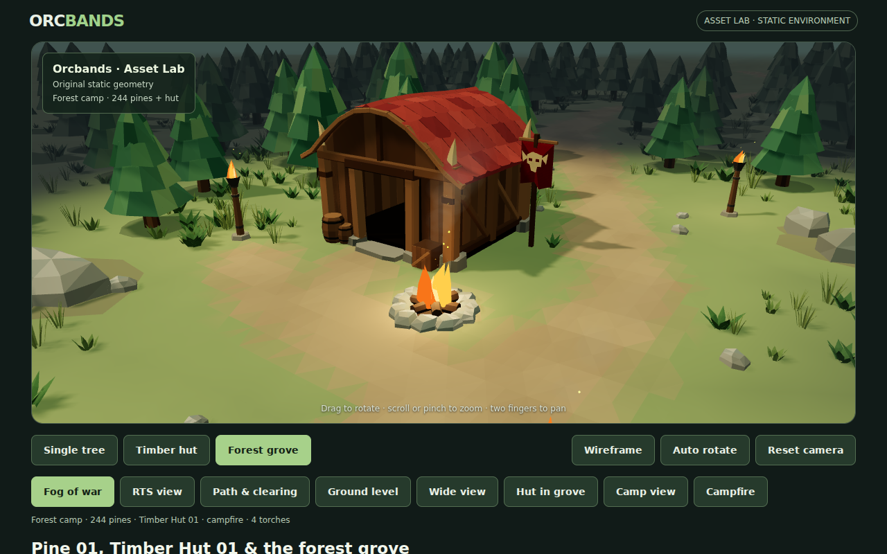
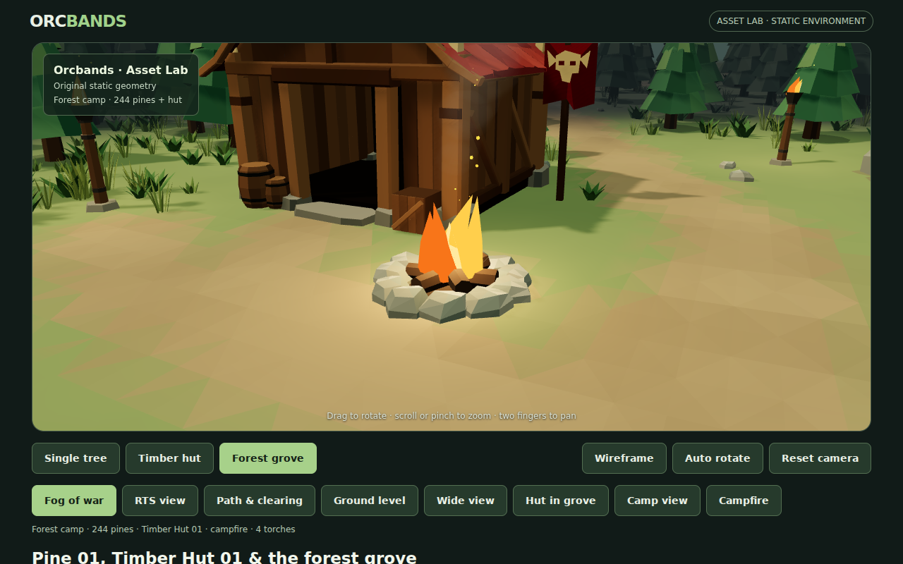
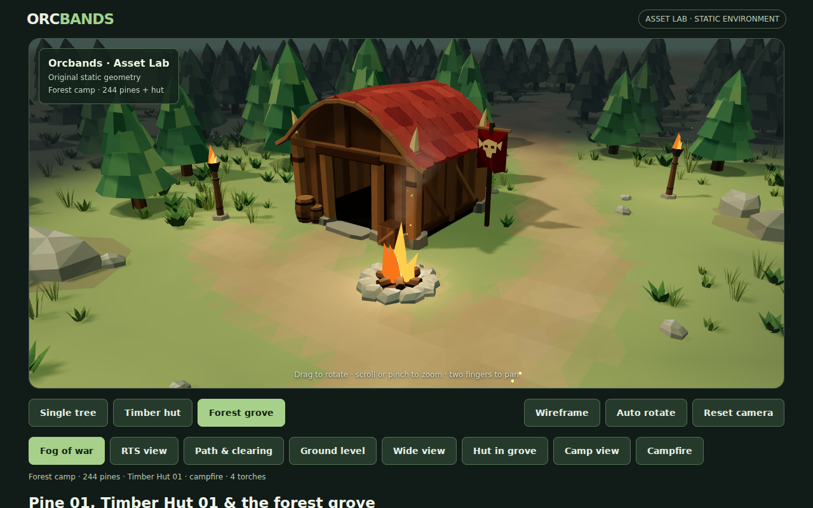

# Fire motion, light and smoke

The campfire and four trail torches now have more varied motion: their flame tips bend, tongues stretch independently, and the coals and nearby light gently change in brightness and warmth. Thin smoke drifts upward and downwind, with a few small rising embers. The existing soft fog and camp composition remain intact.

## Actual WebGL review







[Three-second rendered motion clip](reviews/fire-animation/fire-motion.mp4)

The clip uses 36 actual WebGL canvas captures at deterministic 1/12 second intervals, replayed at 12 fps. It demonstrates motion and is not a hardware performance benchmark. Normal browsing uses elapsed time and requestAnimationFrame.

## Construction

`preview/fire-motion.js` provides shared, deterministic flame motion and a blended flicker signal. It deforms the existing flame geometry from immutable rest coordinates, preserving the bottom ring. Slower stretching, different tip bends and smaller higher-frequency movement avoid synchronized bobbing or a single rotating cone. No new mesh is allocated during animation.

The hearth light varies around 7.2 intensity and the torches around 4.5, retaining their bounded ranges and no dynamic shadows. Brightness and a small orange-to-amber color shift use the same smooth signal, with independent torch phases. The hearth light position moves only a few centimetres; glowing coals also vary slightly. The global sun, ambient illumination and reveal areas stay steady.

`preview/fire-atmosphere.js` maintains two instanced particle pools: 28 translucent smoke puffs and 18 tiny embers across all five fires. Soft view-facing opacity fades the puff silhouettes instead of leaving hard bubble outlines. Puffs expand, drift in a shared light breeze and fade in/out over staggered lifetimes. Torch smoke is thinner and shorter than the hearth plume. Spark scale and brightness fade through their flight. Seeded phases and absolute-time updates allow reproducible captures and arbitrary time seeking, without particle spawning, timers or textures.

Particles do not cast shadows or write depth. They respect the grove visibility mask; its material extension now composes shader cache keys so smoke's per-instance opacity shader remains independent. Particle rendering adds two draw calls and 2,600 triangles. Captured scene counters are 55–61 draw calls and approximately 179,800 triangles, within the existing 66-call / 182,000-triangle budget. The hut studio stays at 21 calls / 3,146 triangles. The fixed 244-tree layout and original Pine 01/hut OBJ/MTL exports and generators remain untouched. No dependencies were added.

## Limits and checks

Smoke is deliberately stylized and lightweight, without fluid simulation, collision, wind simulation or fire spread. Transparent instances share a draw batch rather than sorting every puff separately. Low opacity and small plumes limit overlap artifacts. No bloom, smoke textures, audio or dynamic shadow passes are introduced. Hardware mobile FPS remains unmeasured.

`tools/validate-fire-atmosphere.mjs` checks deterministic smoke matrices and opacity, changing poses, fixed flame bases, deformation beyond scaling, bounded light brightness/color variation and the two particle batches. Existing terrain, hut, campfire, torch and visibility checks remain in the workflow.

The real WebGL smoke test captures the grove from several angles and two different fire poses, verifies smoke/light/flame animation, resumes live playback and exercises desktop/mobile controls, fog toggling and studio isolation without browser errors.

```sh
node tools/validate-fire-atmosphere.mjs
ORCBANDS_LOCAL_THREE=1 node tools/smoke-preview.mjs
# Optional frame sequence for the review clip:
ORCBANDS_LOCAL_THREE=1 ORCBANDS_CAPTURE_FIRE_VIDEO=1 node tools/smoke-preview.mjs
ffmpeg -y -framerate 12 -i smoke-artifacts/fire-frames/%03d.png -vf "scale=960:-2" -c:v libx264 -pix_fmt yuv420p -crf 23 -movflags +faststart smoke-artifacts/fire-motion.mp4
```
