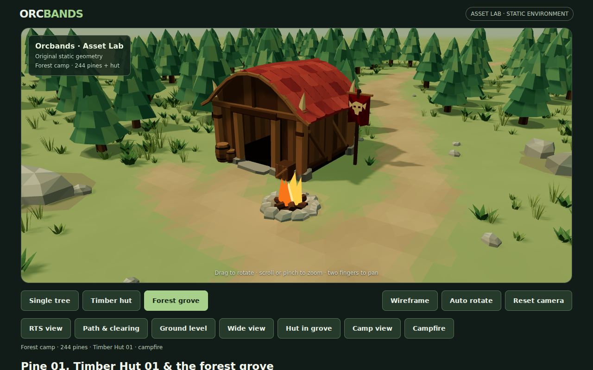
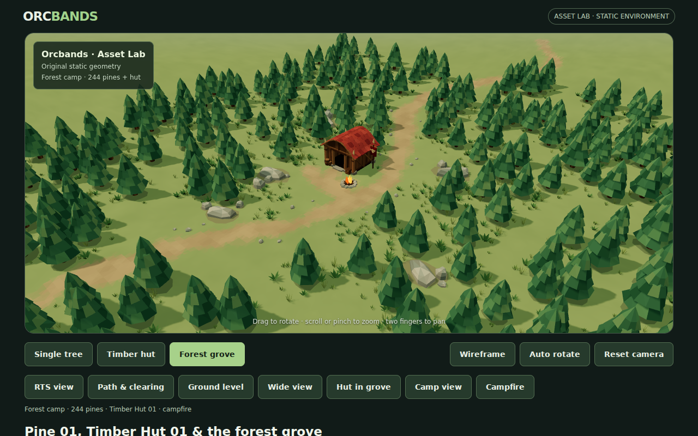
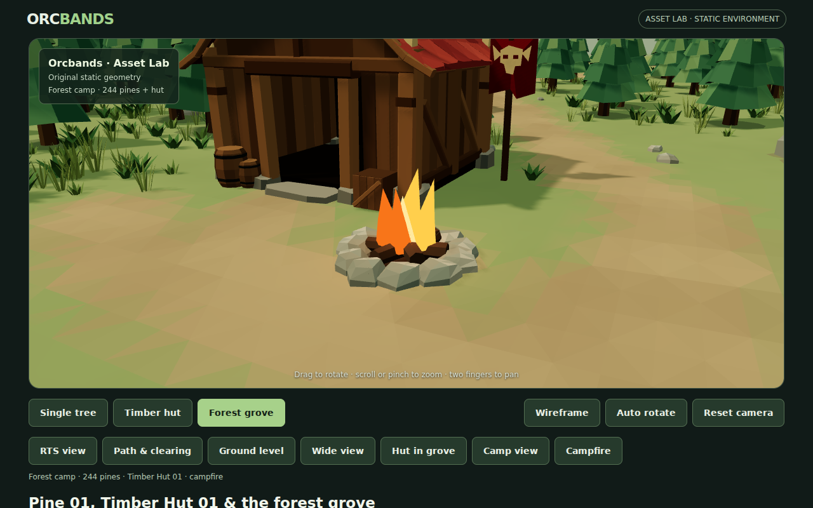
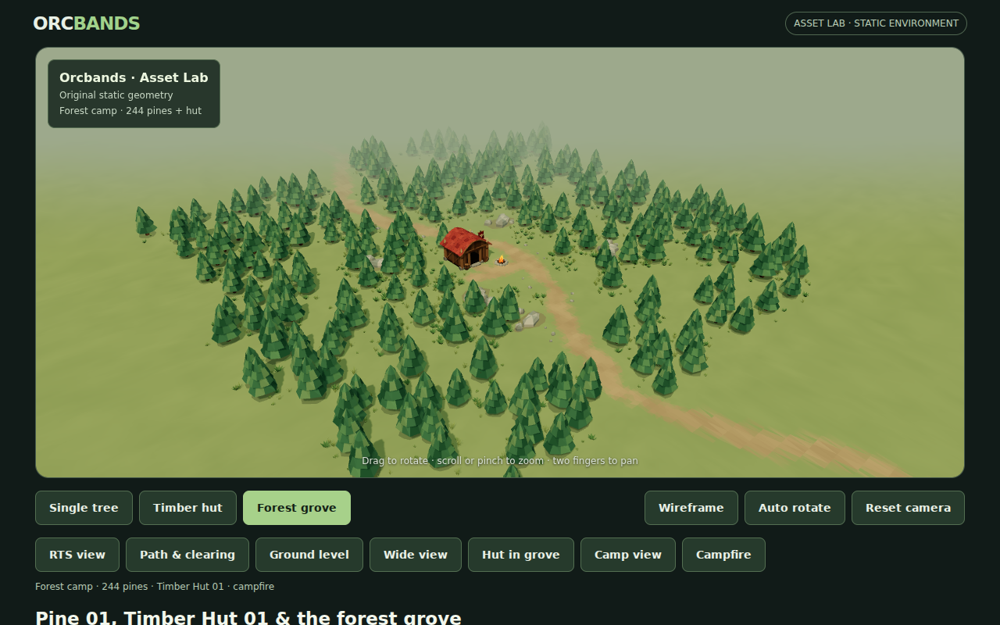
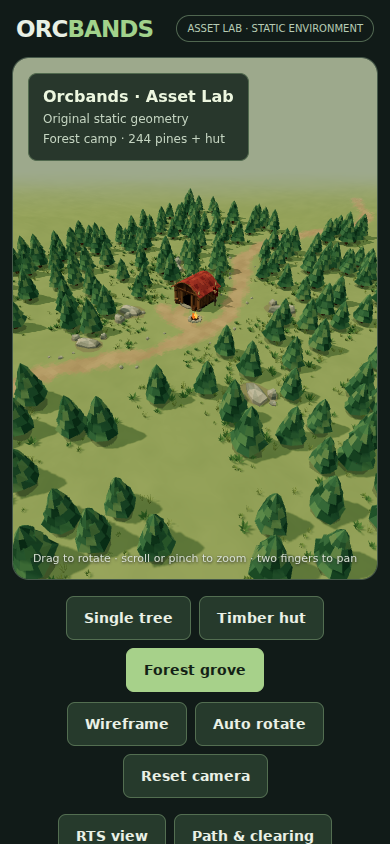

# Forest camp and campfire

For the subsequent torch and visibility addition, including current counters and screenshots, see [Trail torches and fog of war](torches-fog.md). The captures below document the original forest expansion.

The first forest expansion placed the hut clearing inside **244 pines**, up from 36. The original inner tree placements and Pine 01 geometry/palette remain unchanged; 208 additional instances create woodland on all sides, with a second northern layer and connecting trees between the larger pockets. The clearing and winding routes stay open.

## Actual WebGL views

### Camp beside the hut



### Overall forest density



### Hearth geometry



### Wide composition



### Portrait viewport



These are Chromium screenshots of actual geometry. Desktop fire captures use the deterministic pose at time zero; normal browsing animates the flame meshes continuously.

## Woodland construction

`preview/environment-layout.js` retains the inner 36-tree composition and uses independent fixed seeds for the surrounding forest and its ground cover. Deliberate irregular clusters establish the outer woodland. Additional trees connect the pockets so they do not read as isolated islands. Trunk spacing and the full canopy/path clearance margin reject unsuitable placements. All tree scales remain uniform and within 0.83–1.17.

That earlier layout contained 244 pines, 1,618 grass clumps and 38 rocks. Ground cover is lighter per tree in distant woodland, keeping the camp readable and limiting geometry cost. Existing material batches and shared tree geometry remain in use; tree count does not add individual draw calls.

The far camera, orbit limits, fog and shadow coverage now accommodate the expanded woods. A very coarse outer terrain apron avoids exposing a display-platform edge in the wide view. The detailed centre and its terrain-integrated path remain intact.

## Campfire

`preview/campfire.js` exposes `buildCampfire(parent, placement)`, returning a reusable group, an `update(time)` function and read-only metrics. The hearth stands beside the entrance approach at `(0.1, 0.15)` in X/Z. Nearby vegetation and loose rocks are excluded, and a small worn-earth patch integrates the pit with the clearing.

Original geometry includes an eleven-stone irregular ring, a dark ash bed, three crossed logs, glowing coals and five closed faceted flame tongues. The stone ring reuses the existing small angular rock shape. The fire is **797 triangles**, not a billboard or animated texture.

Flame height/width and slight rotation vary smoothly from deterministic time functions while their bases remain anchored. A short-range warm point light flickers gently and does not cast dynamic shadows. The existing static sun-shadow cache remains intact.

The source tree and hut OBJ/MTL files and their generators are unchanged. This adds environment dressing rather than gameplay, spreading fire or resource systems.

## Performance and checks

The reviewed full scene reports **44 draw calls / 176,527 triangles** in `renderer.info.render`, including the forest, hut, ground cover and fire. The hut studio remains at 21 / 3,146. The complete-scene smoke budget is now 50 calls / 180,000 triangles. These are software Chromium complexity counters; mobile hardware frame rate remains unmeasured.

The first forest pass still looked like separate tree islands. Connecting placements produced the final denser woodland. Wide-view review also corrected excess fog and visible ground boundaries.

Passed locally:

- Deterministic layout and actual vertex/matrix/color buffers, finite geometry and path clearance.
- Original tree/hut assets unchanged; existing hut geometry/doorway/roof tests retained.
- Deterministic campfire geometry and pose, animated flame scales, anchored bases, compact bounds, clear path/hearth and bounded light without shadow casting.
- Real WebGL camp, fire close-up, overall, path, low and wide views, plus portrait framing.
- Live animation resumes and advances after the frozen review pose; existing tree/hut scene switching, wireframe, auto rotation, desktop controls and mobile touch checks pass without browser errors.

CI still uploads screenshots and metrics automatically. New source syntax and campfire validation are included in the existing workflow.

```sh
node tools/validate-environment.mjs
node tools/validate-hut.mjs
node tools/validate-campfire.mjs
ORCBANDS_LOCAL_THREE=1 node tools/smoke-preview.mjs
```

The campfire is deliberately stylized. There is no smoke, audio, wind simulation, gameplay or Unity prefab. The woodland remains a finite prototype environment, best judged from the camp and normal RTS views.


The expanded woodland has 1,220 pines (five times the previous 244), within a
220 × 220-unit map envelope. Six seeded winding trail branches connect to
the original north/south route and each other. The camp, original tree IDs and
resource placements remain intact. Tree/grass placement and worn terrain
colours use the same route samples, leaving clear corridors. The map exports
through the existing geometry bridge and is rendered by Unity; the 2,048px
baked shadow mask covers the wider map at the previous texel density.
WASD now pans to ±102 units; maximum dolly distance is 150. Fog of war is still
the camp's static reveal mask: press F to inspect the whole woodland.
These trails do not yet constrain movement: obstacle collision and pathfinding
are the next gameplay task.

The Asset Lab comparison measures 65 draw calls and approximately 644,467
triangles, versus 65 calls and 194,193 before expansion. The forest smoke
budget is 675,000 triangles; draw-call limits remain unchanged. These are
Asset Lab performance counters, not substituted Unity visual evidence.
