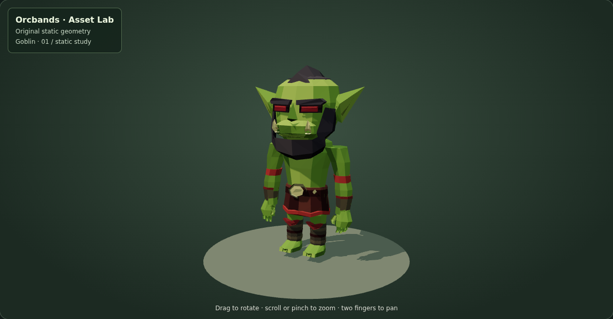
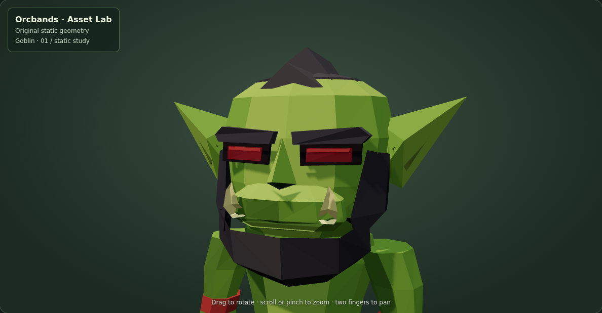
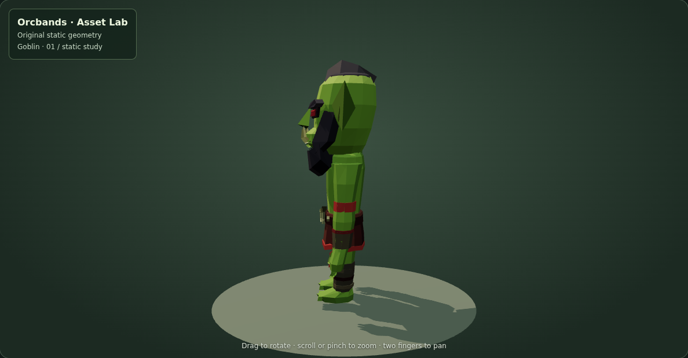
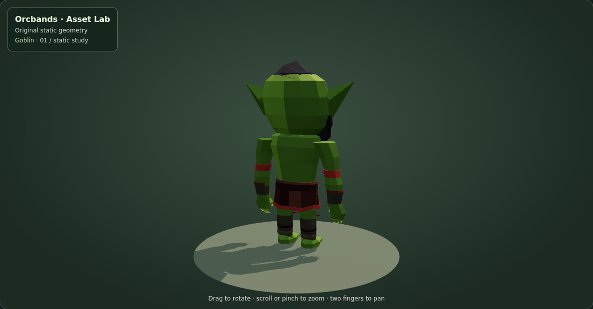
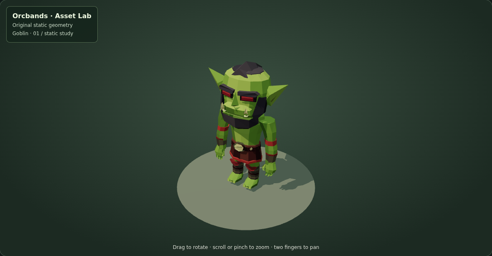

# Goblin 01 — static character study

[Open the model in Asset Lab](https://cubitouch.github.io/Orcbands/?scene=goblin).

A first hand-authored mesh study based on the rightmost goblin in the supplied character lineup. The geometry is authored here from a visual reference; no model or animation files from that character pack are included.

The study concentrates on the oversized angular head, pointed ears, heavy brows, red eyes, small lower tusks, swept dark crest and faceted beard. A leather skirt, large polygonal buckle, red arm bands, wrist cuffs, shin bindings and individual fingers/toes complete the silhouette.



## Inspect and download

Choose **Goblin** in the existing Asset Lab. Orbit, zoom, pan, wireframe, auto rotation and reset work as for the other models. Dedicated front, rear, profile, face-detail and RTS-angle views support inspection. The scene is directly addressable with `?scene=goblin` and works on portrait screens.

- [OBJ mesh](../preview/assets/goblin-01.obj)
- [MTL palette](../preview/assets/goblin-01.mtl)
- [Geometry source](../tools/generate-goblin.mjs)

The model has **2,296 triangles**, 983 exported polygon faces, 72 named parts and a 23-color material palette. Dimensions are approximately **1.43 m wide × 2.183 m high × 0.722 m deep**, in metres with +Y up and the face toward +Z. Viewer geometry is batched by material. The model's feet start at Y=0.022 m.

## Scope and limitations

This is a static first study, with no skeleton, skin weights, animations, UV textures, colliders, LODs or Unity prefab. Parts intersect at joins rather than forming a single welded deformation mesh. It therefore needs topology and rigging work before animation or Mixamo evaluation. The pose is a relaxed standing pose, not a rigging T-pose. The likeness and proportions are approximate and remain subject to art review.

Import the OBJ and MTL together into Blender or Unity to inspect scale and reconnect palette materials if the importer does not associate them automatically.

## Validation

```sh
node tools/generate-goblin.mjs
node tools/validate-goblin.mjs
ORCBANDS_LOCAL_THREE=1 node tools/smoke-goblin.mjs
```

The geometry check parses the shipped OBJ/MTL, verifies deterministic export and finite, non-degenerate triangles, and raycasts the nose, eyes, beard and buckle to confirm that they are visible from the front. The browser check loads the real WebGL scene, captures all camera views, exercises wireframe/rotation/reset, downloads the mesh, verifies the material URL, switches scenes and reloads the direct link, and captures portrait framing. CI also runs the existing forest and camp-interface smoke checks.

Actual browser captures:

| Face detail | Profile |
| --- | --- |
|  |  |

| Rear | RTS angle |
| --- | --- |
|  |  |

[Wireframe](reviews/goblin-01/wireframe.png) · [Portrait](reviews/goblin-01/mobile.png)
