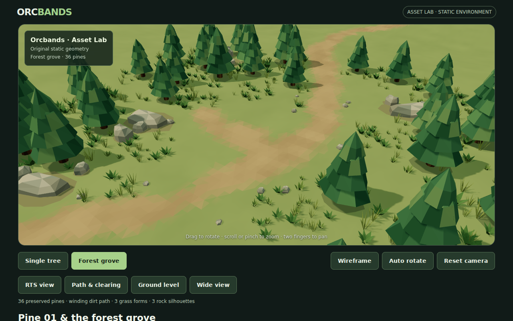
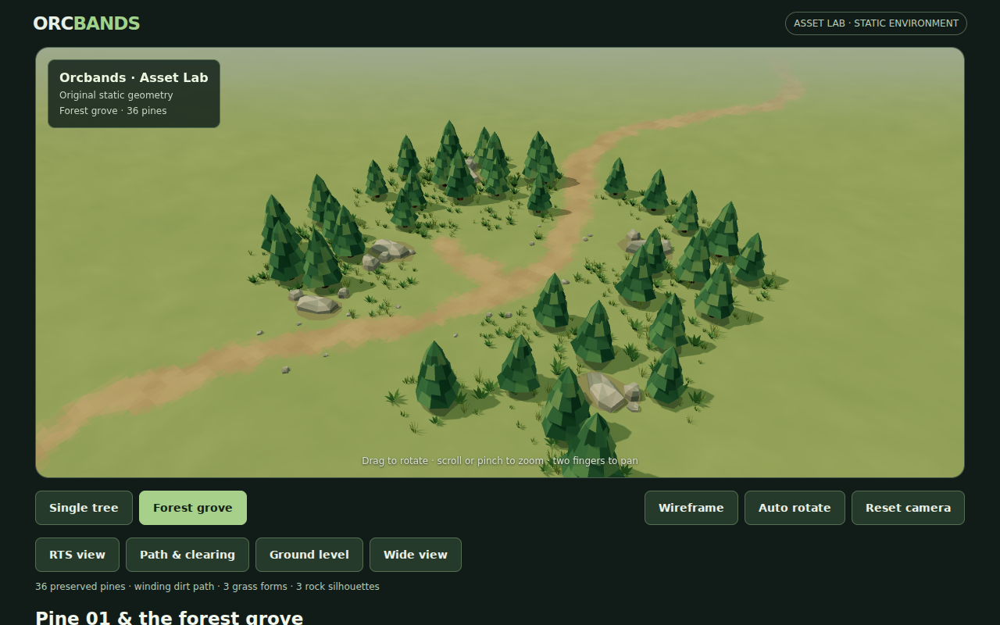
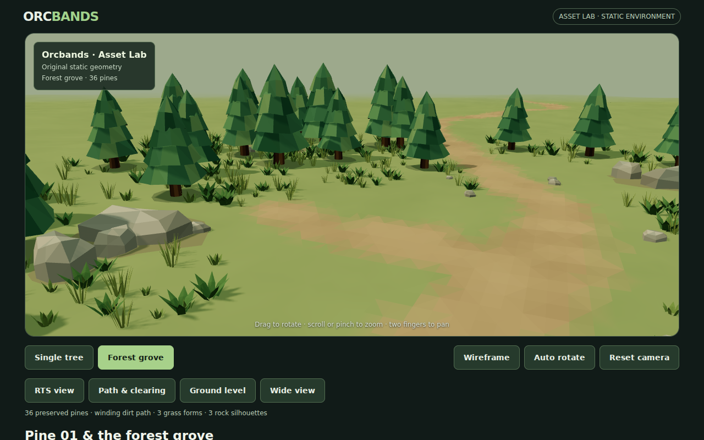
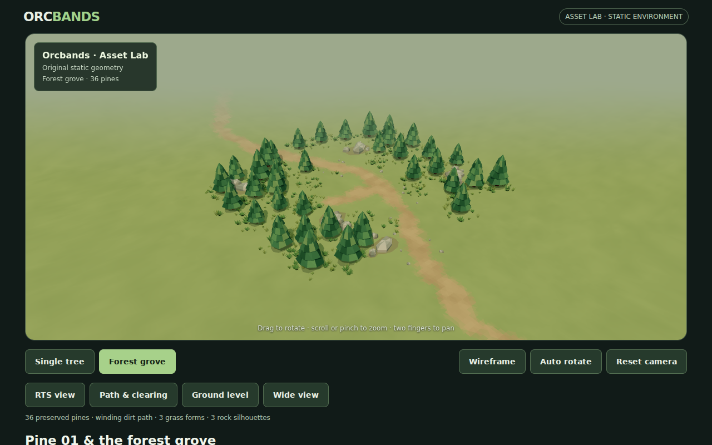
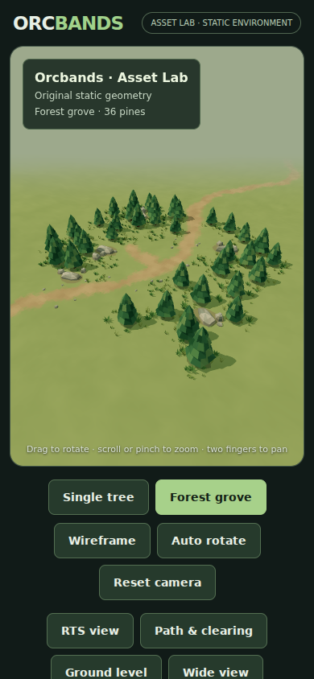

# Forest path naturalism

Follow-up to ENV-02 / PR #24. The latest generated reference suggested a worn-in camp track: broken earth/turf boundaries, irregular soil patches and a widening at gathering spaces. The implementation takes those cues as original WebGL geometry, with no texture, illustration, external asset or shader dependency.

## What changed

The separate three-tone ribbon is gone. The path is now part of the forest floor, so there is no raised strip, parallel shoulder band or depth offset. Small route deviations and variable width break up the large regular curve. A short foot trail enters the western clearing and opens into an irregular trampled apron. The centre stays available for future gameplay.

Seeded coherent noise shapes broken turf boundaries and earth-color patches. Earth and shoulder triangles receive flat colors; the surrounding meadow remains quiet with smoothly varying vertex colors. An initial blended pass looked airbrushed, so the final version uses discrete faceted patches at the dirt/grass transition.

The original pine geometry, materials, studio and downloads are unchanged. One northern instance moved slightly to clear the revised bend. A rock-cluster anchor shifted away from the new side trail; the same rock and plant libraries are retained. Current layout: **36 pines, 36 rocks, 608 grass clumps**.

## Real WebGL review

Original [path view](reviews/env-02/grove-path.png) and [overall composition](reviews/env-02/grove-overall.png) remain available for comparison.

### Path and clearing

### Overall composition

### Low angle

### Opposite wide view

### Portrait

## Assembly and cost

- `preview/ground-surface.js` supplies deterministic coherent noise and ground variation.
- `preview/environment-layout.js` owns the main route, clearing trail, worn-area coverage and shared prop-exclusion corridor.
- `preview/environment.js` colors a single continuous floor mesh. A nonuniform grid puts the most vertices along the path; woodland edges and distant meadow use fewer vertices. Matching shared rows prevent cracks between resolutions. No separate path overlay remains.
- `preview/app.js` caches static shadows and refreshes them on scene changes, reset, wireframe changes or active auto rotation. Camera movement alone does not regenerate an unchanged shadow map.

The desktop wide and portrait captures report **15 draw calls / 88,394 triangles** in `renderer.info.render`, compared with 16 / 57,569 in ENV-02. The additional terrain vertices produce the broken soil edge without textures or more draw calls. The smoke-test scene budget is now 100,000 triangles. These are complexity counters, not real-device FPS measurements.

## Verification

The existing CI runs `node tools/validate-environment.mjs` and `ORCBANDS_LOCAL_THREE=1 node tools/smoke-preview.mjs`. Install the same pinned development packages and Chromium as described in [ENV-02](environment-env-02.md#validation-and-reproduction).

Passed locally: seeded placement and actual buffers reproduce bit-for-bit; main route and side trail keep props clear; terrain/path faces point upward; the path remains visible along its sampled centre; single-tree and grove loading, desktop controls, auto rotation, reset and portrait touch controls work with no browser errors. Four desktop views and the portrait view were inspected. CI still uploads fresh screenshots and metrics automatically.

The tree OBJ and MTL regenerate byte-for-byte. The surface remains deliberately stylized: the patch boundaries are faceted, and the terrain is almost flat. There are no sculpted ruts, displaced soil, wind or gameplay. Mobile hardware performance remains to be checked.
