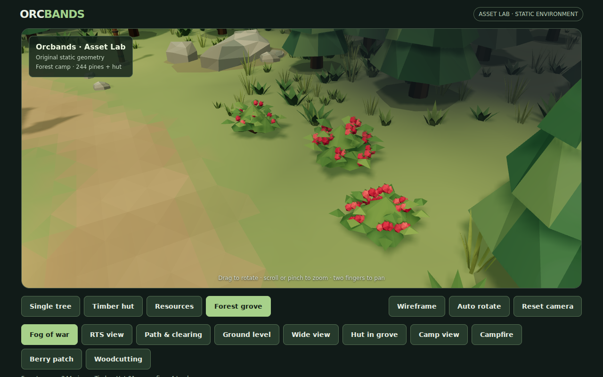
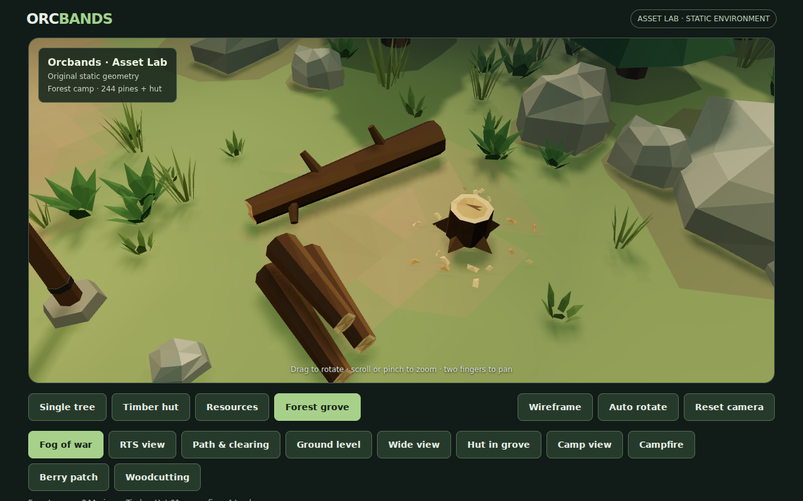
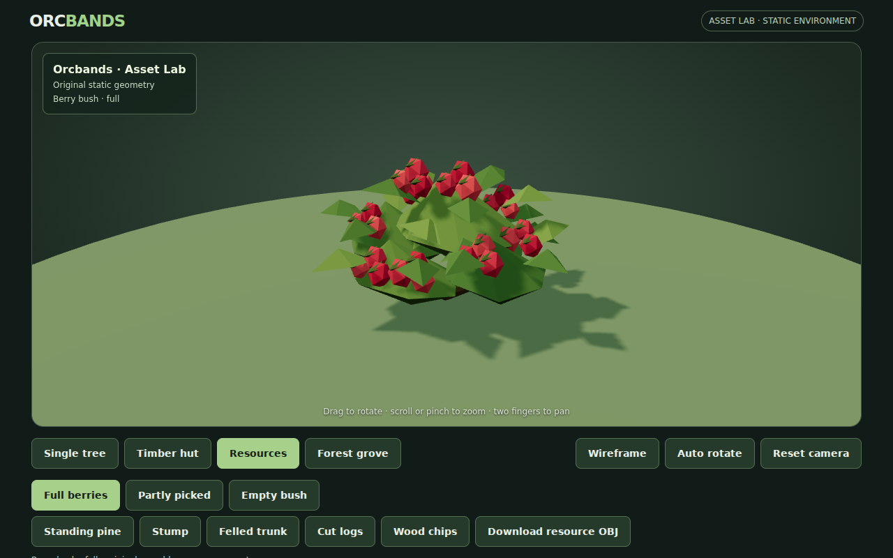
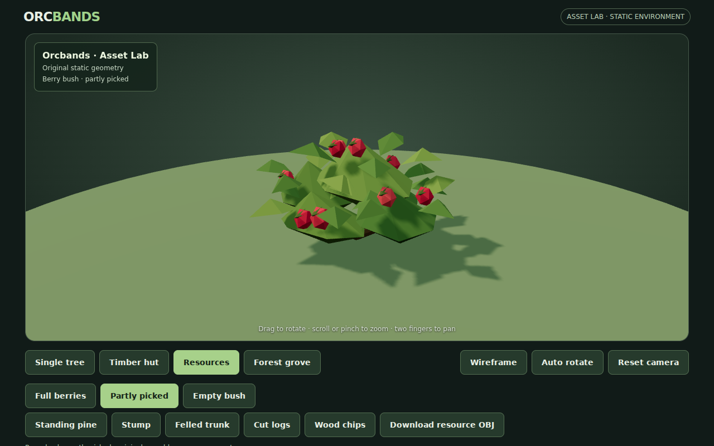
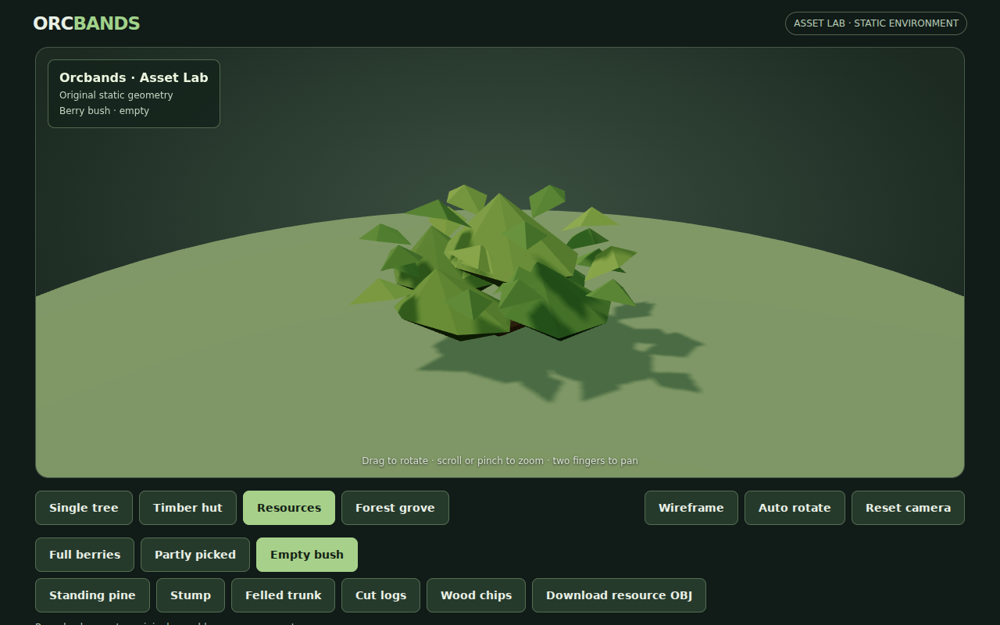
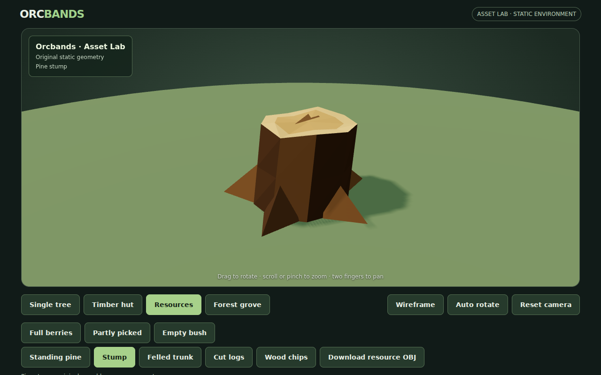
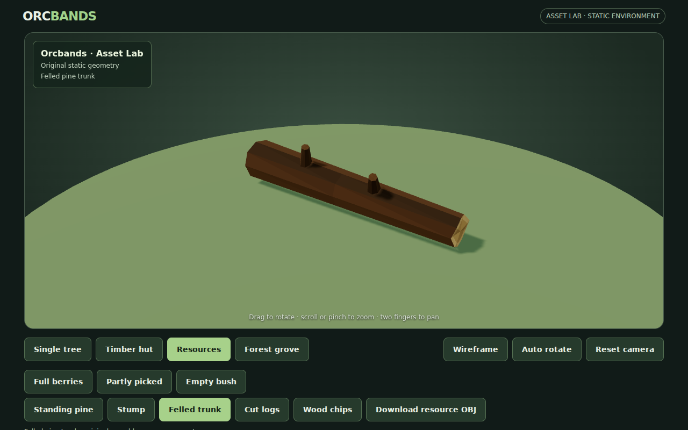

# Resource art 01: pine harvesting forms and berry bushes

First batch from the [non-character asset inventory, issue #30](https://github.com/cubitouch/Orcbands/issues/30). This adds original static resource forms and an inspector for their states. Harvesting, regrowth, resource amounts and worker interactions are future gameplay work.

## Actual WebGL views















These are actual Chromium WebGL screenshots. The first berry camera was obscured by an existing pine, so it was moved to look from the path. Inspector framing was tightened around the small assets. The tapered trunk's resting angle was also corrected so the narrow end does not hover.

## Art and reusable definitions

`preview/resources.js` owns the geometry library, cached by resource kind/state. All geometry is original and deterministic, uses metres and +Y up, and shares one rough, faceted vertex-color material.

| Kind | State key | Appearance | Triangles |
|---|---|---|---:|
| Berry bush | `bush/full` | Five irregular leafy masses, branching stems, pointed broad leaves and 30 red berries | 1,140 |
| Berry bush | `bush/picked` | Same foliage, 10 remaining berries | 620 |
| Berry bush | `bush/empty` | Same foliage with no berries | 360 |
| Tree | `wood/standing` | Existing Pine 01, cloned without changing source geometry or palette | Existing asset |
| Tree | `wood/stump` | Nine-sided bark, root flares, pale sapwood rim, heartwood and broad cut split | 106 |
| Tree | `wood/trunk` | Tapered fallen pine trunk with small branch stubs and exposed ends | 174 |
| Tree | `wood/logs` | Three cut sections with readable end grain | 270 |
| Tree | `wood/chips` | Nineteen irregular split-wood flakes | 114 |

Berry placement changes across states while the entire underlying foliage stays identical. The bush is about two metres wide and one metre tall: low enough to remain subordinate to Pine 01. Leaf greens match the woodland, with restrained red/pink fruit for readability. The wood uses Pine 01's bark vocabulary, with fresh, lighter cut surfaces.

The source Pine 01 and Timber Hut 01 OBJ/MTL files, generators and Single Tree viewer remain unchanged. All 244 standing-tree placements remain intact; the woodcutting area represents a separate previously worked patch.

## Grove placement

`RESOURCE_PLACEMENTS` in `preview/environment-layout.js` defines six bushes in two irregular edge pockets: three full, two partly picked and one empty. A small woodcutting site beside the clearing combines the stump, chips, fallen trunk and cut logs. A lightly worn work apron integrates it with the forest floor.

Resource footprints exclude grass and loose rocks without changing the random sequences or standing-tree placement. The resulting grove has 244 pines, 1,592 grass clumps and 36 rocks. Routes, hut entrance, torches and hearth remain clear. Wood props follow the local terrain slope; chips conform individually to the ground surface.

`buildGroveResources()` merges all the new resource forms into **one draw batch**, totalling 5,684 triangles before removed ground cover is accounted for. Shared geometry is reused in the inspector. Fog, lighting, fire animation and existing camera controls remain available.

## Inspector and downloads

Choose **Resources**, then one of eight state buttons. Each selection has its own framing; orbit, zoom, wireframe, auto rotate and reset continue to work. State deep links use `?scene=resources&asset=bush/full` (or another key from the table). Studio views disable grove fog.

**Download resource OBJ** exports the current asset in local coordinates, independently of inspector rotation. The self-contained OBJ stores sRGB colors with the common RGB-per-vertex extension. An OBJ color round trip is validated, including actual palette values. Importers must support vertex colors; Unity may need a vertex-color-compatible material. Pine 01's existing OBJ/MTL downloads remain available unchanged.

## Verification and limitations

`tools/validate-resources.mjs` verifies independent deterministic buffers, finite geometry/colors, exact foliage preservation across berry states, berry counts, colored OBJ round trips, upward-facing stump cuts, grounded studio bounds, supported trunk ends, resource/path/prop clearance and the single grove batch.

The extended browser smoke captures all eight inspector states, both grove resource areas, overall/path/low/wide views and mobile resource framing. It exercises state switching, deep-link reloads, actual RGB OBJ download, wireframe, auto rotate, camera reset, all previous desktop/mobile controls and studio/fog isolation. CI keeps automatic screenshot artifacts.

The captured grove overview reports **62 draw calls / 184,521 triangles**; hut studio remains 21 / 3,146. The grove triangle budget is 190,000; the existing 66-call budget is retained. Captures are complexity checks in software Chromium, not a mobile hardware FPS benchmark. These props have no collision, inventory quantities or harvesting animation yet. Resource visibility is authored static art for future systems.

```sh
node tools/validate-resources.mjs
node tools/validate-environment.mjs
node tools/validate-hut.mjs
node tools/validate-campfire.mjs
node tools/validate-camp-visibility.mjs
node tools/validate-fire-atmosphere.mjs
ORCBANDS_LOCAL_THREE=1 node tools/smoke-preview.mjs
```
