# Resource art 02: stone and stockpiles

Next batch from [asset inventory #30](https://github.com/cubitouch/Orcbands/issues/30): stone resources and resource stockpiles. These are static art states for future gathering/storage gameplay.

## Actual WebGL review

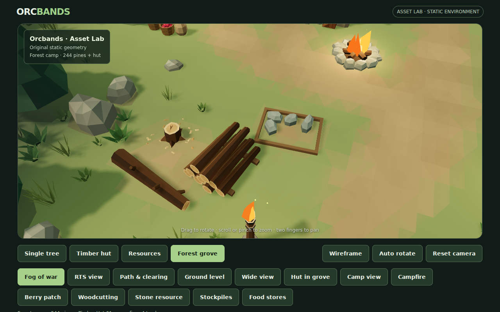

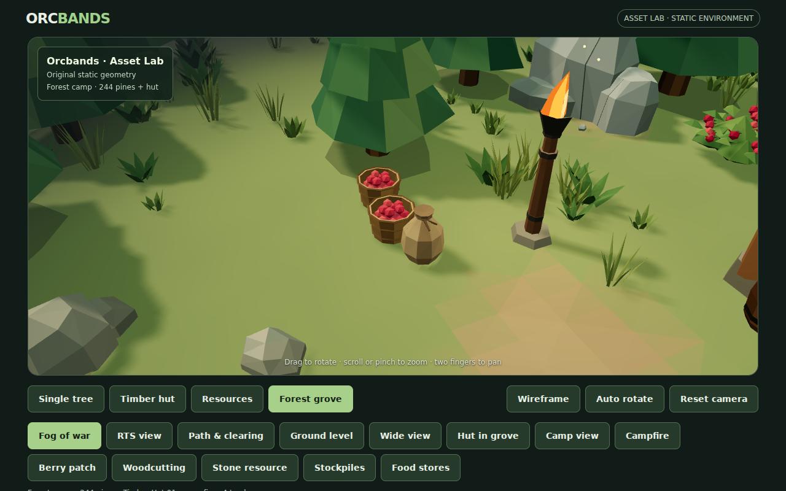

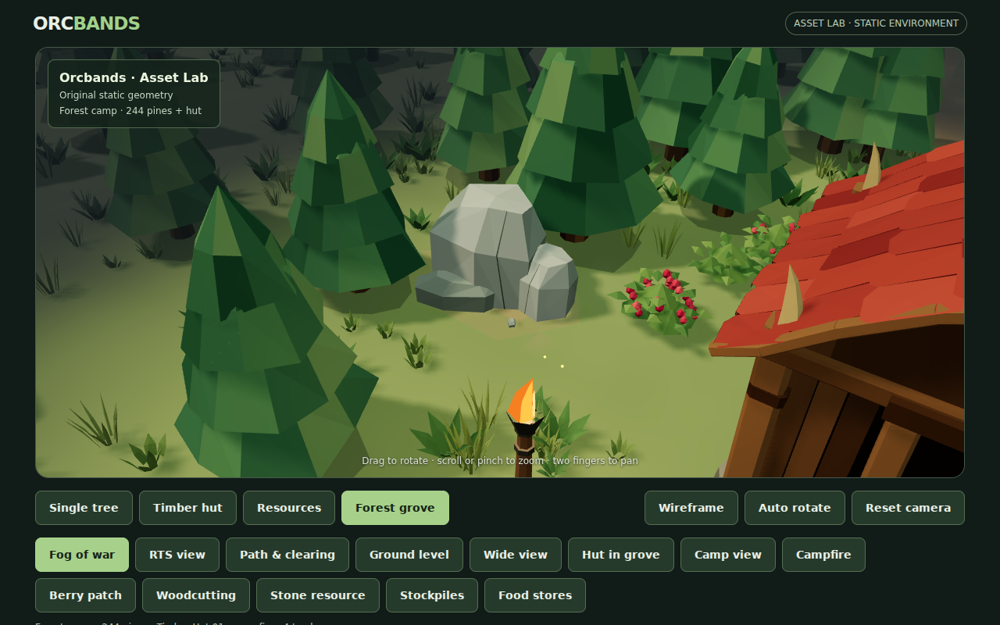

| Stone resource | Depleted remnant | Loose stone |
|---|---|---|
| 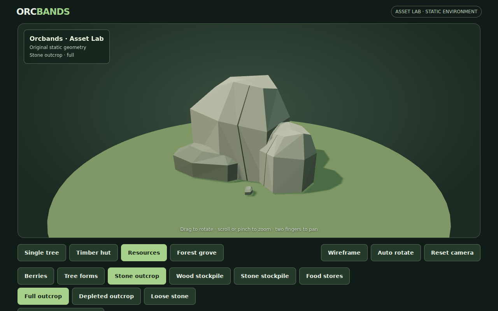 | 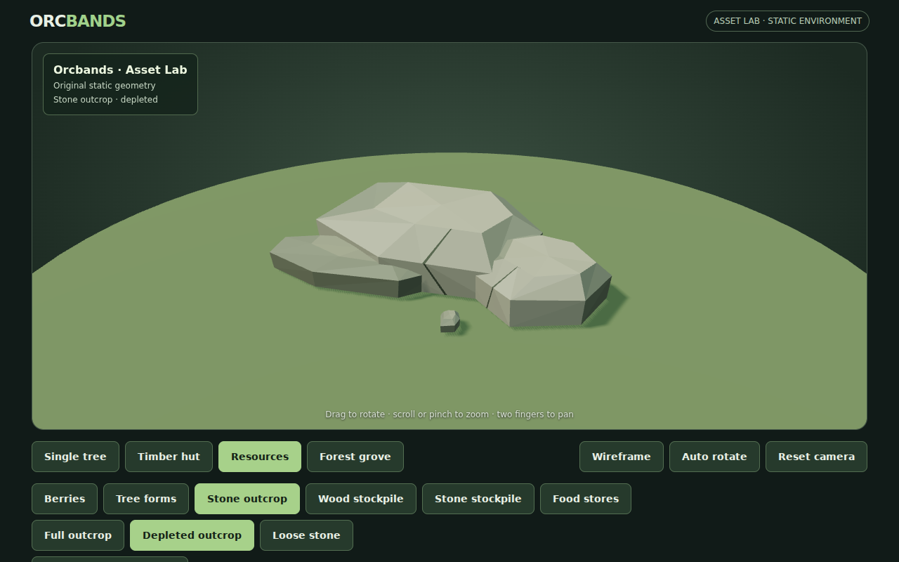 | 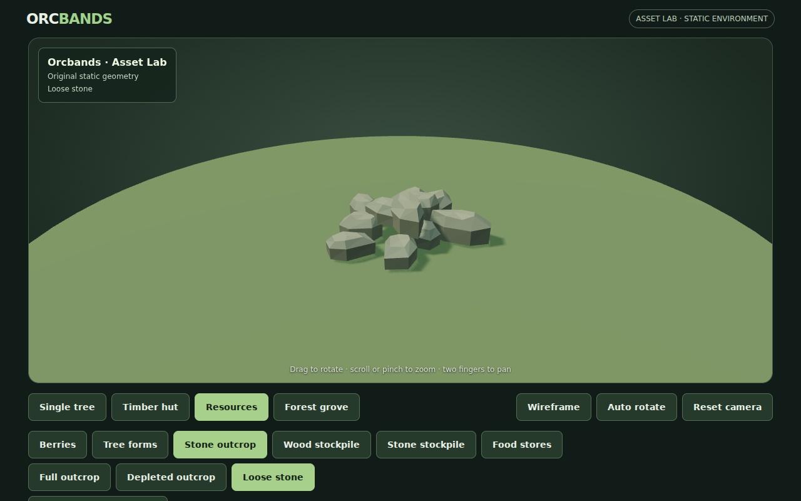 |

| Stockpile | Empty | Partial | Full |
|---|---|---|---|
| Wood | 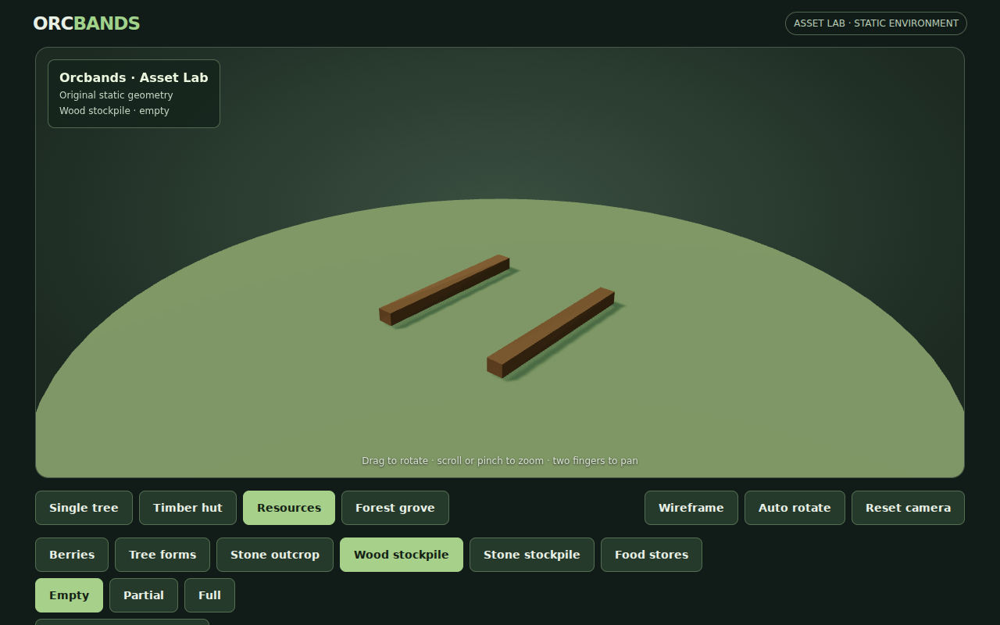 | 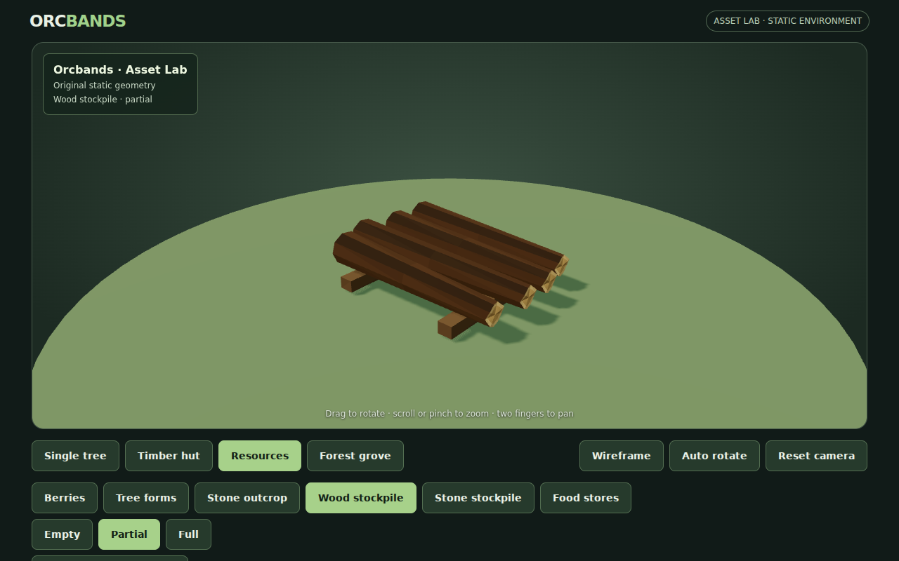 | 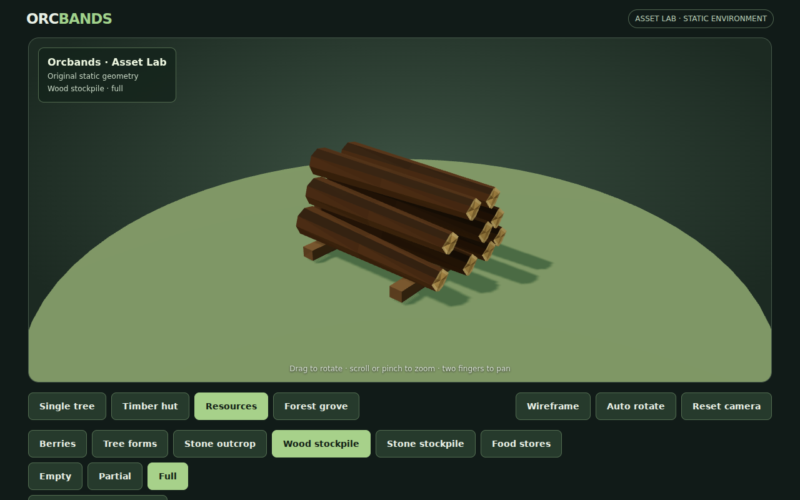 |
| Stone | 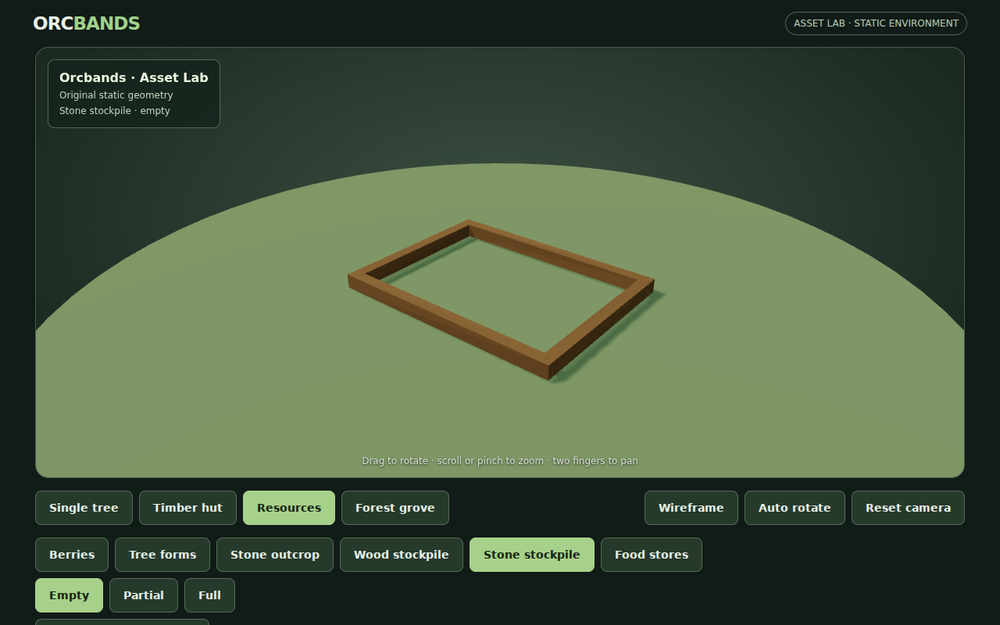 | 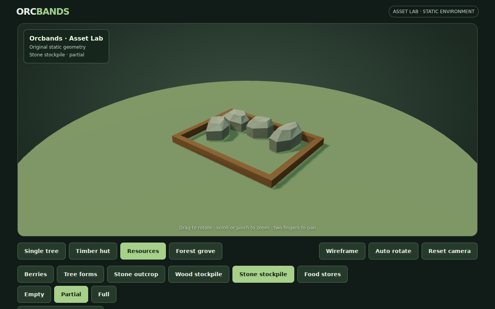 |  |
| Food | 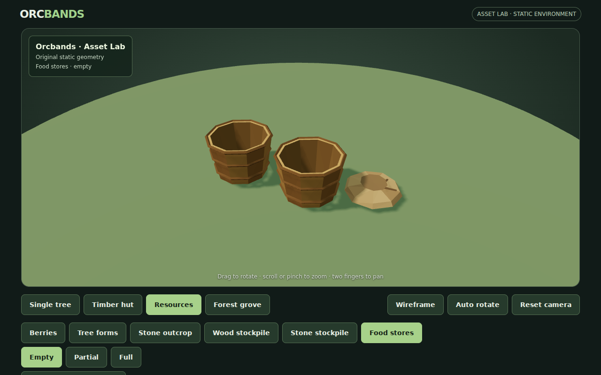 | 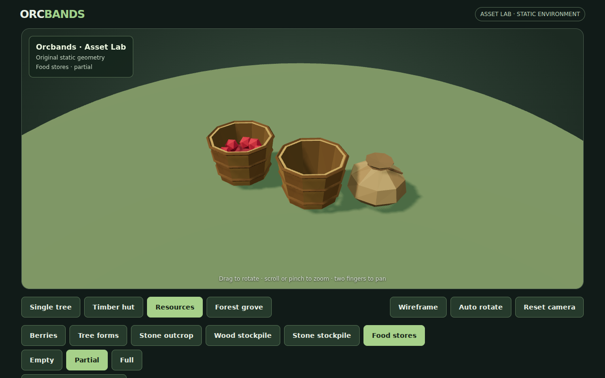 | 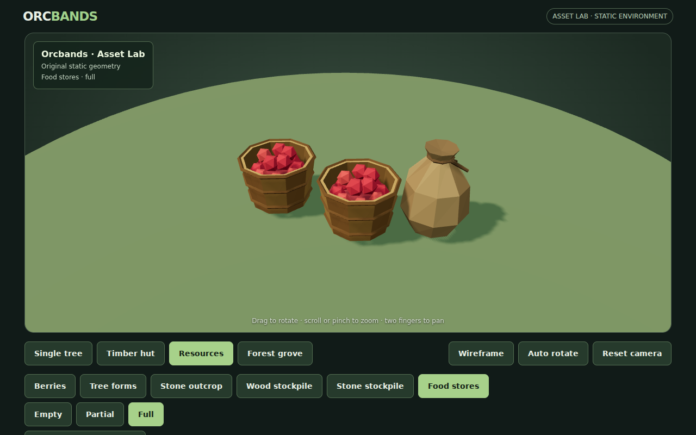 |

These are actual Chromium WebGL captures. Visual iteration broke up initially straight stone cracks, added visible sack ties and moved the sack alongside the baskets. The food camera was raised and partial contents adjusted so a half-filled basket can be distinguished from an empty one.

## Definitions and composition

`preview/storage-resources.js` adds twelve states:

- `stone/full`, `stone/depleted`, `stone/rubble`: three authored broken stone silhouettes, fractured pale faces and low loose fragments. Depletion preserves the large node's horizontal footprint while lowering it from about 1.78 m to 0.43 m.
- `woodpile/empty`, `partial`, `full`: the same two timber runners with 0, 4 or 9 cut logs, in supported tiers. Logs reuse the existing pine-cut geometry and bark/end-grain palette.
- `stonepile/empty`, `partial`, `full`: the same low timber boundary containing 0, 4 or 12 angular stones.
- `food/empty`, `partial`, `full`: two open baskets with fixed walls/rims, 0, 8 or 24 visible berries and a sack that flattens as storage empties. Filled baskets include a subdued bulk surface underneath the visible fruit. These counts describe the meshes, not gameplay resource quantities.

All geometry is deterministic, faceted and original, with vertex colors and no textures or new dependencies. `preview/resource-geometry.js` contains the shared geometry helpers extracted without changing the existing tree/berry buffers. Original Pine 01 and hut assets, generators, palettes and all 244 standing-tree placements remain intact.

The grove gains a full stone node on the western shoulder and a depleted node on the eastern edge. The previous small cut-log display becomes a larger wood stockpile in the existing work area. A partial stone stockpile sits beside it; food stores sit near the end of the clearing trail. A worn apron integrates the storage/mining footprints with the terrain. Nearby grass and decorative rocks are cleared, while routes, torches, hearth and hut remain unobstructed.

All grove resources still share **one merged draw batch** and the existing rough vertex-color material. Rigid props follow the ground slope; the original chips still conform to the surface. The new resource batch totals 8,578 triangles, including the first batch's retained props.

## Inspector and reuse

Resources are now grouped into six families: Berries, Tree forms, Stone outcrop, Wood stockpile, Stone stockpile and Food stores. Family buttons reveal only their relevant states, remember the last inspected state during the session and retain the existing orbit, zoom, reset, wireframe, auto-rotate and colored OBJ download behavior. There are twenty states in total.

Deep links retain the existing format, for example `?scene=resources&asset=stone/full` or `?scene=resources&asset=food/partial`. The resource studio stays independent of grove fog. OBJ files use the RGB-per-vertex extension and need vertex-color-compatible import/material support, as in the first batch.

## Verification and limits

`tools/validate-resources.mjs` now covers all twenty states: independently reproduced geometry, finite buffers, palettes retained through OBJ export/import, resource clearance and grounded bounds. `tools/validate-stockpiles.mjs` checks monotonic fill amounts, fixed supports/container shells, valid triangles, the outcrop's retained footprint, clear depletion and ground contact. Before/after checks confirmed the first batch's mesh buffers were unchanged by extracting the shared helpers.

The browser smoke captures every state, the three new grove views, overall/path/low/wide views and a mobile food-store view. It tests actual family/state buttons, deep-link reloads, RGB OBJ download, previous controls and fire/fog behavior, with no browser errors. CI preserves screenshot artifacts automatically.

The captured grove overview reports **62 draw calls / 185,939 triangles**; hut studio remains 21 / 3,146. The layout has 244 standing pines, 1,556 grass clumps and 33 decorative rocks. The existing 66-call budget is retained; the triangle ceiling is 195,000. Render counters are recorded with the screenshots. Hardware mobile FPS remains unmeasured. No mining/gathering logic, automatic inventory accounting, storage capacity, collisions or hauling is introduced.

```sh
node tools/validate-stockpiles.mjs
node tools/validate-resources.mjs
node tools/validate-environment.mjs
ORCBANDS_LOCAL_THREE=1 node tools/smoke-preview.mjs
```
