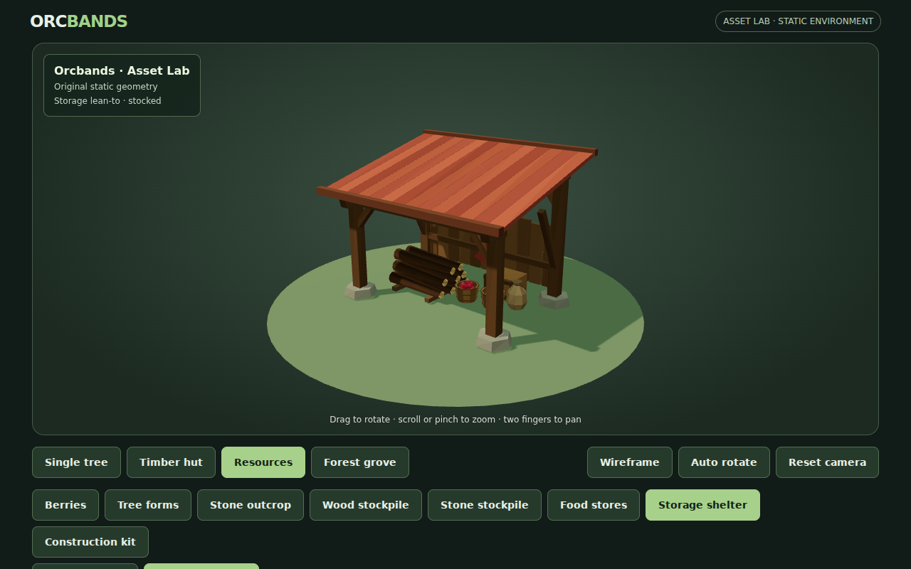
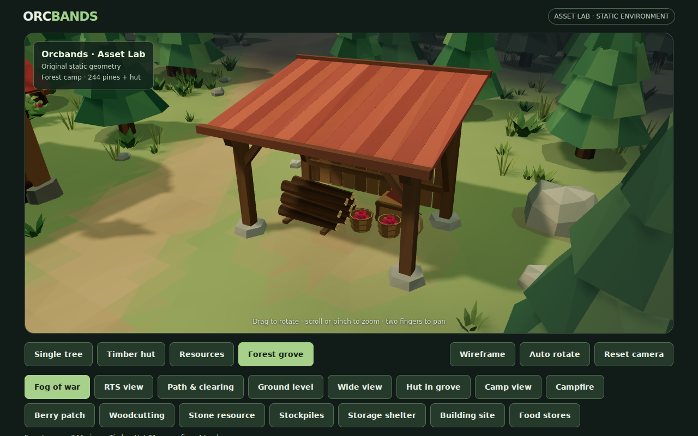
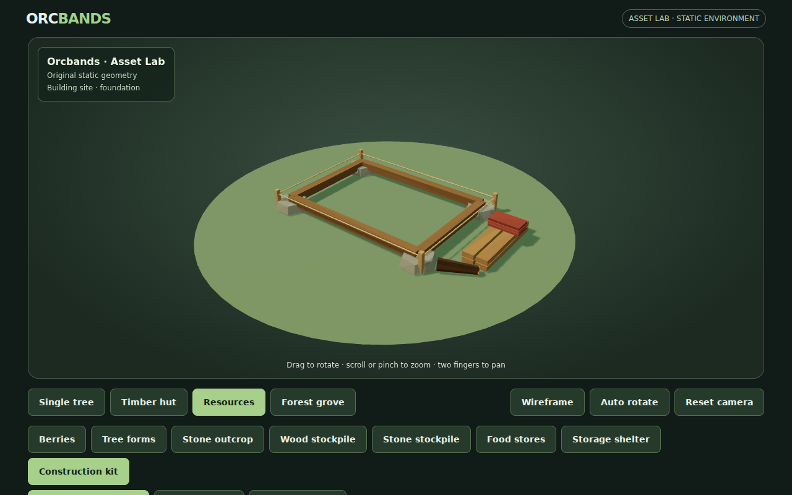
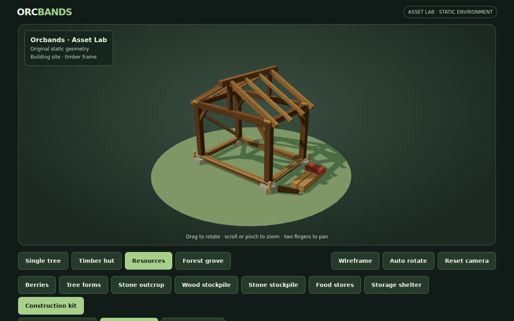
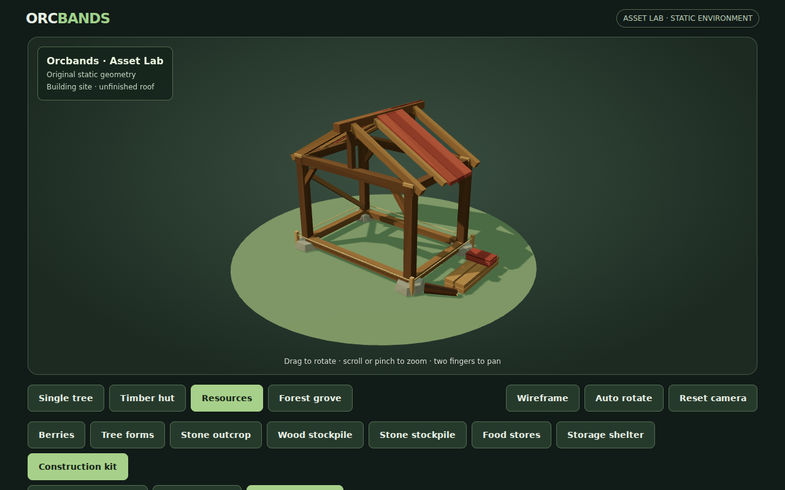
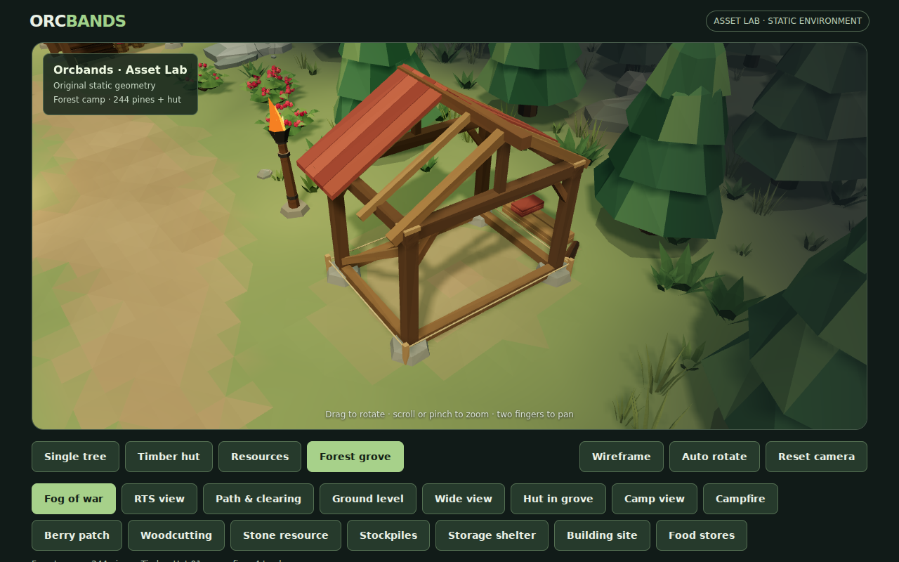

# Settlement art 01: storage shelter and construction stages

Next two entries from [asset inventory #30](https://github.com/cubitouch/Orcbands/issues/30), following the approved stone-stockpile refinement in #33.

## Actual WebGL review





| Marked foundation | Timber frame | Unfinished roof |
|---|---|---|
|  |  |  |



[Empty shelter](reviews/settlement-01/resource-shelter-empty.png) · [Mobile shelter](reviews/settlement-01/shelter-stocked-mobile.png) · [Mobile construction](reviews/settlement-01/construction-roof-mobile.png) · [Overall settlement](reviews/settlement-01/grove-overall.png)

## Storage lean-to

A roughly 4 m wide timber lean-to with a sloping muted red roof, stone post pads, pegged caps, corner braces and ventilated back slats. The front remains open for unloading. Empty and stocked states share the exact same shell. The stocked state reuses the existing cut-log and food-store geometry, with a small dressed crate. A worn apron in front makes the unloading side readable from the RTS camera.

The shell is 710 triangles; stocked is 3,062 triangles. Roof boards overlap slightly to close an initially visible daylight seam. The shelter is placed northeast of the camp, near the existing trail torch. Its complete roof footprint is clear of routes, trunks, the hut and resource props.

## Construction kit

Three cumulative art states share a small building footprint:

1. **Foundation:** corner stones, raised timber sills, layout stakes and string lines.
2. **Frame:** the same foundation plus posts, head beams, corner braces, two gables, exposed rafters and ridge beam.
3. **Unfinished roof:** the same frame plus incomplete red board strips on both slopes. Enough rafters remain exposed to read as work in progress.

Loose timbers, roofing boards and a short offcut form a reusable clutter group beside the footprint. All three stages retain the same foundation; frame and unfinished-roof stages retain the same structural frame. The stages are 478, 814 and 898 triangles respectively.

The grove contains an unfinished building site south of the camp. Grass and loose decorative rocks are cleared underneath both new sites, and irregular worn ground integrates the footprints. All 244 standing pine placements, approved resource definitions, hut and original downloads remain intact.

## Viewer and exports

Resources now includes eight families and twenty-five states. New family buttons expose Empty/Stocked shelter and Foundation/Frame/Unfinished roof. Per-state framing, deep links, family state memory, wireframe, rotation, reset and colored OBJ downloads follow the existing viewer behavior. New grove camera buttons focus the shelter and building site.

Example links: `?scene=resources&asset=shelter/stocked` and `?scene=resources&asset=construction/roof`.

`preview/settlement-resources.js` shares timber, pad and roof-board helpers across the structures and reuses the existing geometry/material system. Grove resources remain one merged draw batch, with no new dependencies, textures or materials. OBJ exports retain RGB vertex colors and require compatible import/material support, as before.

## Verification and limits

`tools/validate-settlement.mjs` verifies cumulative stage geometry, an unchanged shelter shell, valid triangles, an open unloading bay, overhead roof coverage, terrain contact, complete footprints and separation from other resources. The existing resource validator covers independent generation, finite geometry, OBJ palette round trips, route/trunk clearance and vegetation exclusion across all twenty-five states. Existing hut, fire, fog, environment and stockpile checks remain enabled in CI.

Real Chromium/WebGL review captures all five new states, reloads the unfinished-roof deep link, checks both structures in portrait and inspects the shelter, building site and overall grove. The ordinary full browser smoke now visits the two new grove views and all twenty-five resource states, preserving existing desktop/mobile control, fire/fog and download checks. The browser harness normalizes scroll before desktop pointer checks and waits for observed camera movement, so a longer inspector does not leave the scripted drag off-canvas or race a slow software render. Automatic screenshot artifacts remain enabled.

The reviewed overview reports 62 draw calls / 188,837 triangles, within the existing 66-call / 195,000-triangle budget. The two structures add 3,960 triangles to the shared resource batch; cleared vegetation offsets part of the scene increase. Hardware mobile FPS remains unmeasured. These are static reusable art states: no build queue, construction animation, hauling, collision or storage accounting is introduced.

```sh
node tools/validate-settlement.mjs
node tools/validate-resources.mjs
ORCBANDS_LOCAL_THREE=1 node tools/smoke-preview.mjs
```
