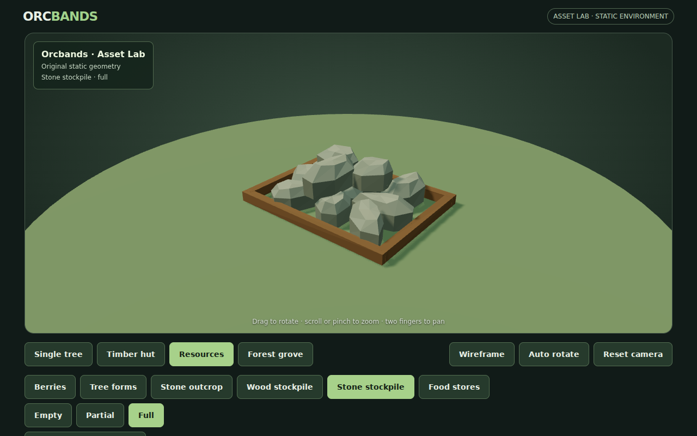
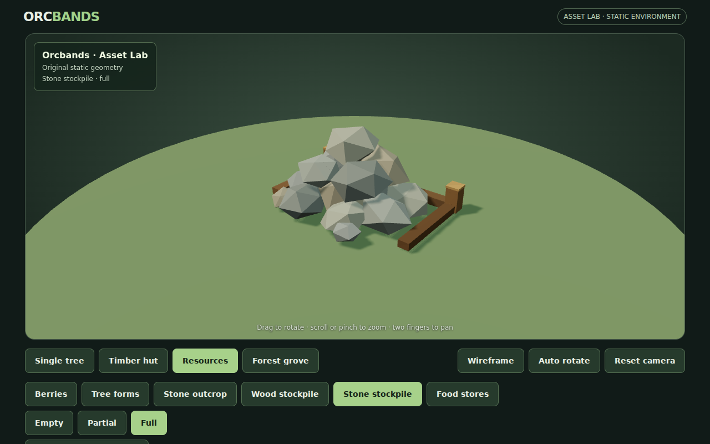
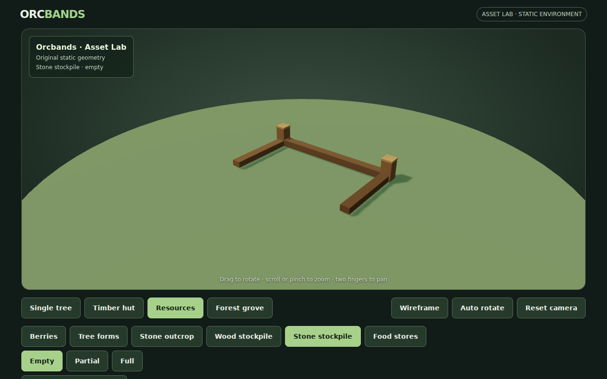
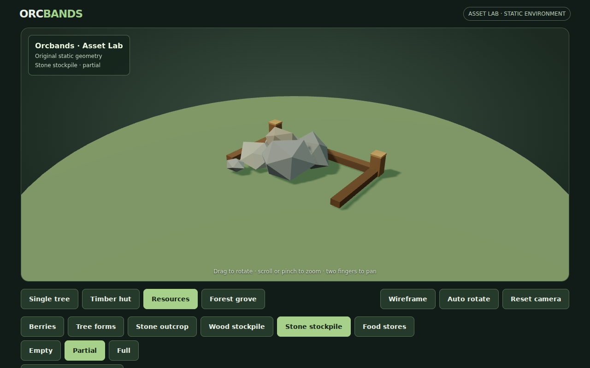
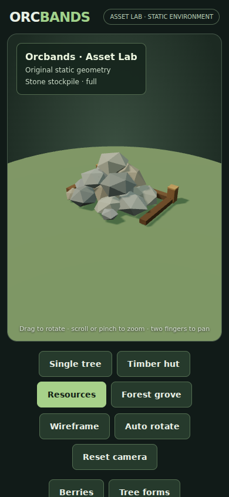
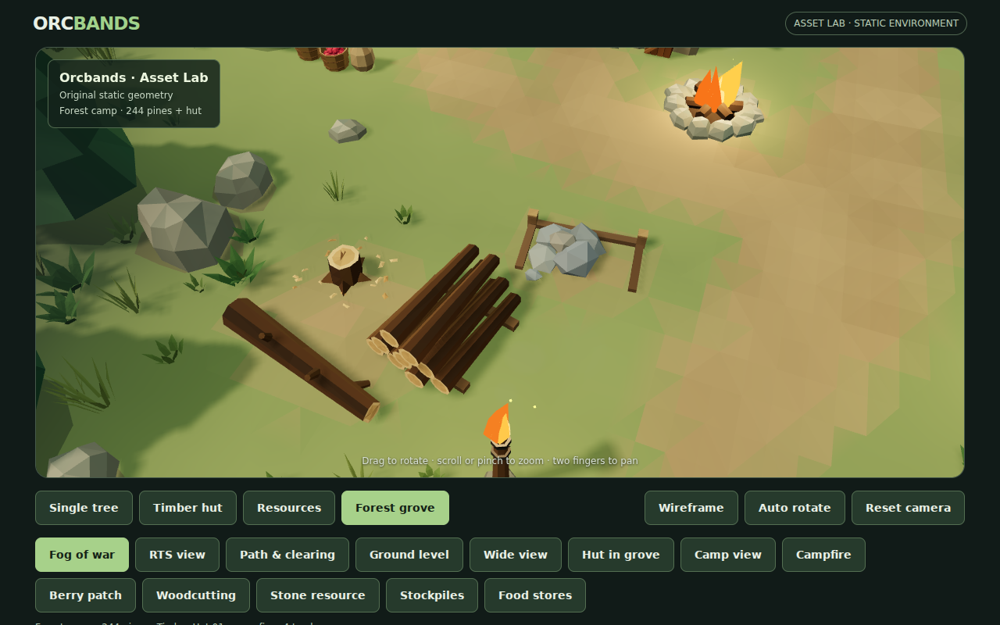

# Stone stockpile visual refinement

Follow-up to owner feedback on resource art 02, refs #30. The stone heap previously looked like a regular array of small quarry columns inside a rectangular planter.

## Rendered comparison

| Previous full state | Revised full state |
|---|---|
|  |  |

| Empty | Partial | Full |
|---|---|---|
|  |  |  |

## Changes

- Replace the closed rectangular rim with a low, open-front timber bay and two pegged rear corners.
- Give the stockpile its own chipped, irregular stone forms instead of reusing the quarry's column-like silhouette.
- Build a tapered overlapping mound with varied widths, heights, rotations and neutral grey/slate tones. Small loose pieces soften its edge; broad broken resting faces keep the lower stones planted.
- Full storage has fifteen pieces; partial storage has a low cluster of six; empty storage retains the same timber supports. Counts describe visible art, not gameplay quantities.

Only stone stockpile geometry changes. Standing/depleted quarry nodes, wood and food storage, tree and berry states, scene lighting and the original assets retain their existing definitions. The resource batch uses the existing shared vertex-color material, with no added textures, dependencies or draw batches.

## Validation

Stockpile, resource and environment validators check valid triangles, deterministic buffers, fixed supports across fill states, monotonic contents, terrain contact, route clearance and colored OBJ round trips. The full browser control smoke passed during this refinement. A final focused WebGL pass after the resting-face adjustment captured all three states, the full state on mobile, wireframe toggling and in-grove placement without page errors. Its stockyard sample reports 44 draw calls / 185,030 triangles, inside the existing 66-call / 195,000-triangle budget. Captures and metrics are included alongside this note.

These are static art states. Capacity accounting, hauling, collision and hardware mobile FPS remain outside this visual refinement.
