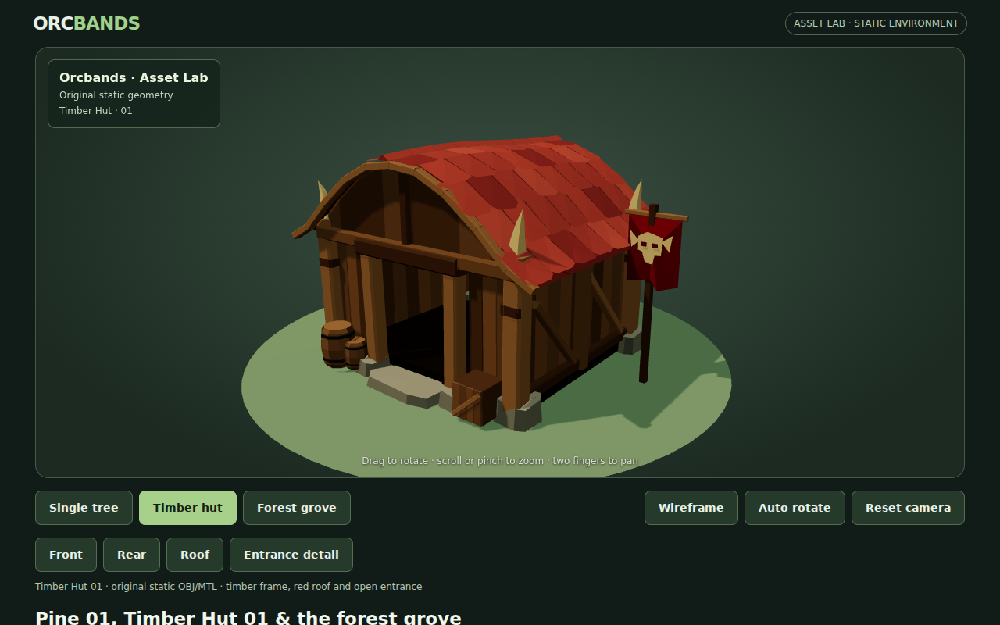
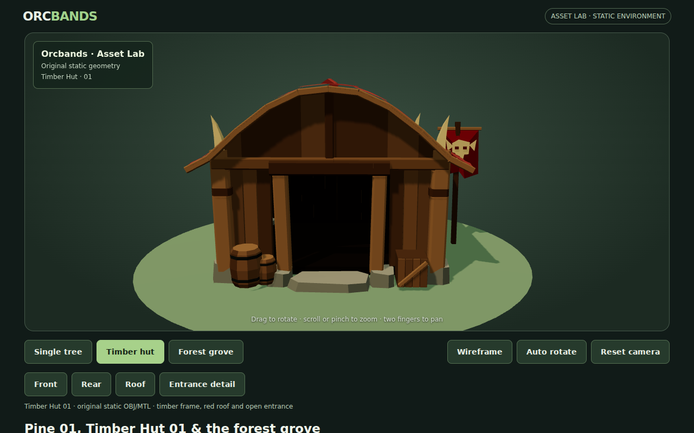
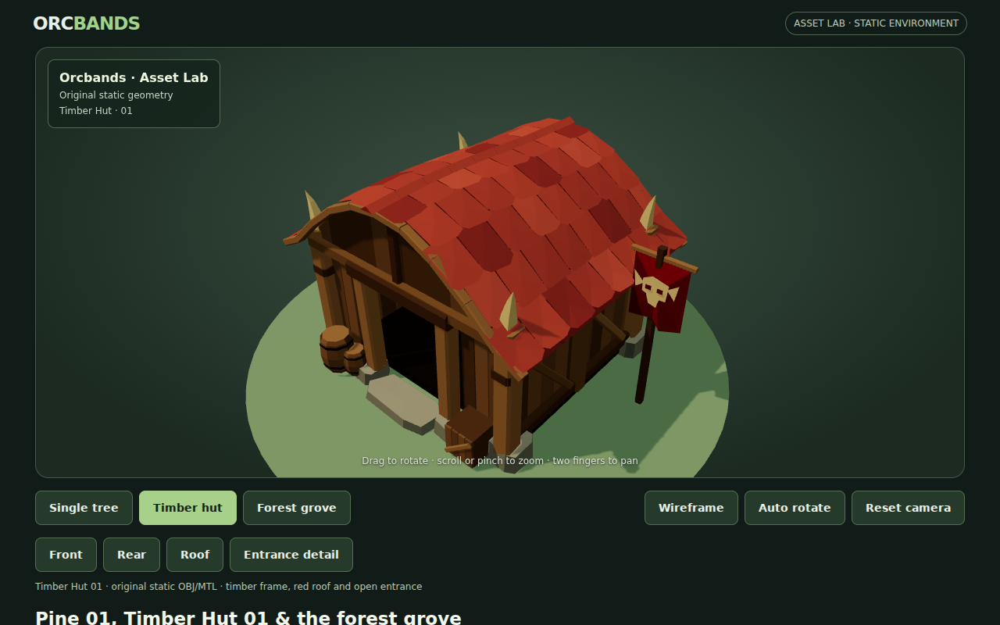
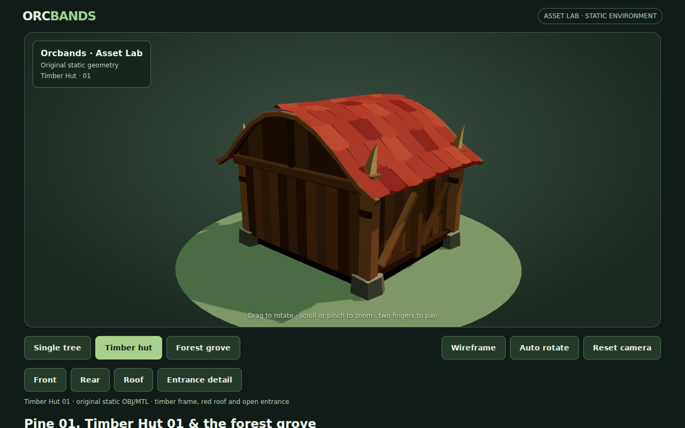
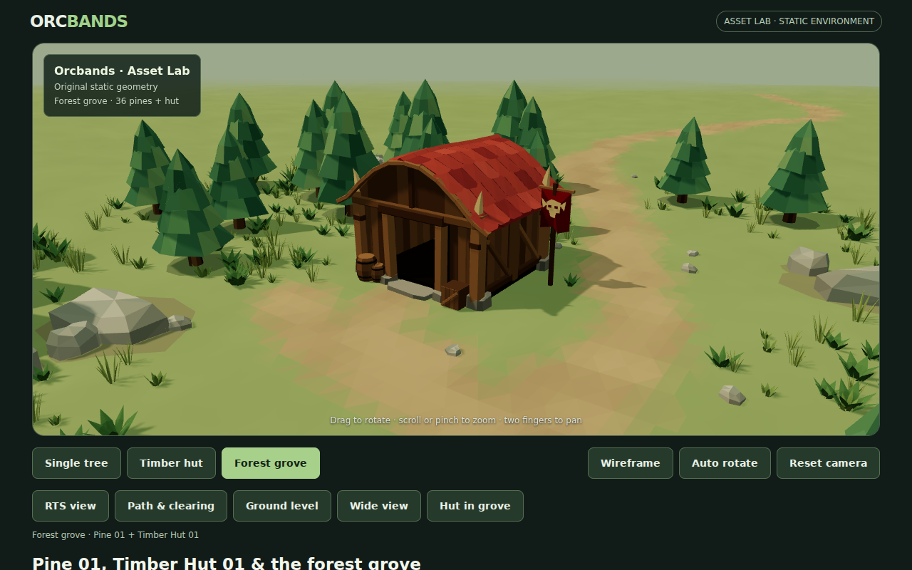
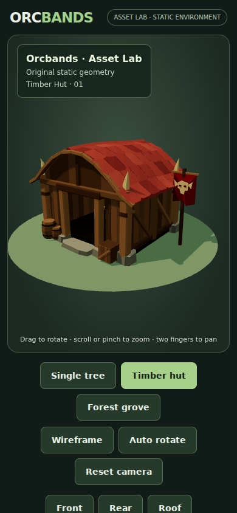

# Timber Hut 01

An original static hut based on the larger red-roofed timber building in the owner's supplied camp artwork. This is actual reusable OBJ/MTL geometry displayed in WebGL, not an image or a character asset.

## Shape and materials

The main cues are the broad bowed red roof, heavy corner posts, warm vertical wall planks, diagonal side braces, pale horn-like post caps, irregular stone footings and a dark recessed entrance. Roof panels have staggered seams, chipped hems and restrained color variation. Curved front and rear gables follow the roof profile; the overhang has a real underside. The doorway is physically open and reveals the interior floor and back wall.

Two small barrels, a crate and an original tribe pennant provide the entrance dressing seen in the reference. They are named parts of the same asset, so they can be separated later in a modelling tool. The emblem is a simple original horned-mask shape, not a licensed game logo.

The model uses **3,082 triangles**, **1,635 polygon faces**, 6,352 exported position entries and 20 diffuse material colors. Positions are duplicated across face boundaries to preserve a faceted appearance. The roof is about 4.1 metres tall. Overall bounds, including the pennant, barrels, overhang and buried pad bases, are approximately **6.47 × 4.23 × 5.06 metres** in X/Y/Z. Metres, +Y up, entrance toward +Z.

## Real browser screenshots

All captures below are from Chromium rendering the shipped OBJ/MTL through the actual Asset Lab. No generated illustration is used as the model or scene background.

### Three-quarter studio



### Front and open doorway



### Roof construction



### Rear and side framing



### In the forest clearing



### Portrait framing



## Viewer and downloads

The **Timber hut** tab and `?scene=hut` open an independent studio. Front, Rear, Roof and Entrance detail presets supplement the existing orbit, zoom, pan, Wireframe, Auto rotate and Reset controls. Portrait framing widens the field of view. The default remains Single tree.

- [Hut OBJ](../preview/assets/timber-hut-01.obj)
- [Hut MTL](../preview/assets/timber-hut-01.mtl)
- [Deterministic generator](../tools/generate-hut.mjs)

Keep the OBJ and MTL in the same folder for import. Materials are flat colors without textures. Verify normals, scale and material reconstruction in the target Unity project. There is no prefab, collider, LOD, animation or gameplay behavior yet.

## Grove integration and performance

One hut instance stands at `(-3, -3.8)` in the western clearing. A short worn approach meets the front step. Vegetation and rocks avoid the building footprint; the main winding route remains open. Pine 01's generator, OBJ, MTL and tree-instance layout remain unchanged.

`instanceAsset()` consolidates an OBJ's numerous named material runs into one instanced batch per material. The hut's 216 named modelling parts therefore do not become 216 draw calls. Studio and grove share source geometry/materials and maintain independent transforms.

Recorded `renderer.info.render` metrics:

| View | Calls | Triangles |
| --- | ---: | ---: |
| Hut studio, including ground | 21 | 3,146 |
| Grove with hut | 35 | 90,696 |

The static shadow cache is retained. These are scene-complexity measurements from software Chromium, not a real-device FPS guarantee. The complete grove remains inside its 100,000-triangle smoke-test budget; its draw-call budget increases from 24 to 40 to accommodate the hut's 20 materials.

Deployment stamps the revision through local module imports and OBJ/MTL requests, so a browser's previously cached environment module cannot break the new hut tab after deployment.

## Visual iteration and validation

The initial red was too saturated and the wood too dark. The revised palette is warmer and more restrained. Roof panels initially looked crinkled; reduced centre lift and per-panel color grouping made them read as broad hand-cut panels. A straight gable left daylight beneath the curved roof, so its wall and fascia now follow the same profile. A separate underside closes the overhang from below.

CI preserves the Pine 01 byte-for-byte export comparison and adds the same hut regeneration comparison. `tools/validate-hut.mjs` checks deterministic shipped exports, finite/nondegenerate triangles, required modelling parts, curved-gable closure, underside coverage, an actually open doorway, roof coverage, a clear building footprint and separation from the main path. Existing seeded-environment checks remain enabled.

The real WebGL smoke test covers the hut studio and four review views, Wireframe, Auto rotate, reset, the hut-in-grove view, portrait framing and direct hut permalink reload, alongside the previous Pine 01/grove desktop and touch checks. All captures and metrics remain automatic CI artifacts.

Run locally from the repository root:

```sh
node tools/generate-hut.mjs
npm install --no-save --ignore-scripts playwright@1.56.1 three@0.166.1
npx playwright install --with-deps chromium
node tools/validate-hut.mjs
node tools/validate-environment.mjs
ORCBANDS_LOCAL_THREE=1 node tools/smoke-preview.mjs
```

## Remaining differences from the artwork

The result preserves the building's main visual cues, but is still a modest low-poly approximation. It uses plain-color geometry rather than the reference's painted surface treatment. The roof is more regular, joinery is simplified and the interior is only lightly modelled. Surrounding camp furniture, fire, characters, buildings and gameplay have not been added. The hut is left in a separate review PR; the approved path update was merged independently.
