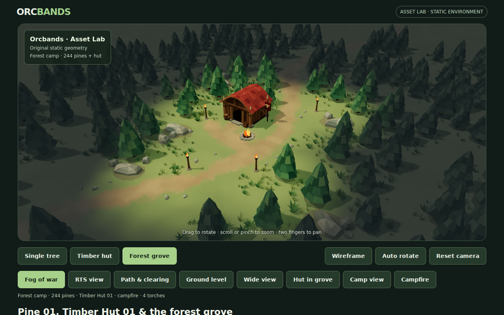
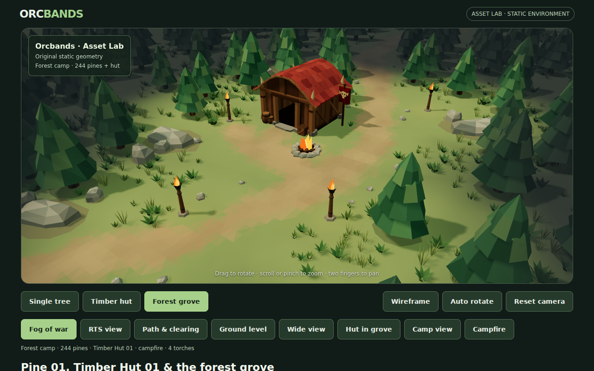
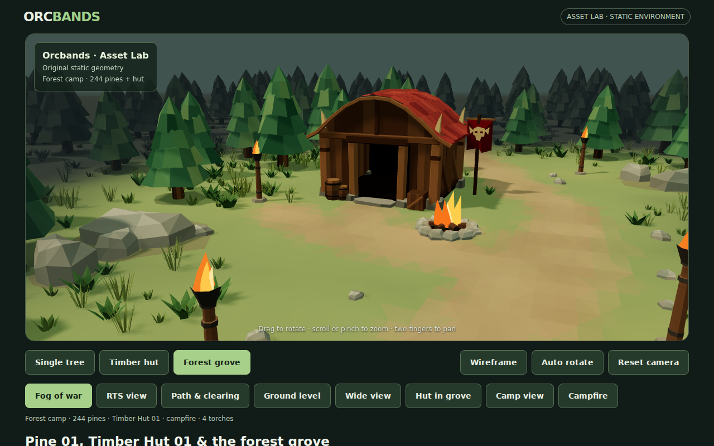
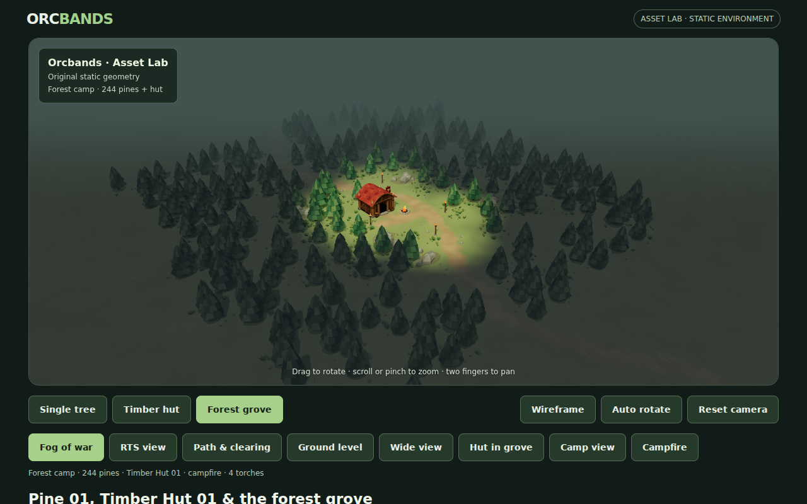
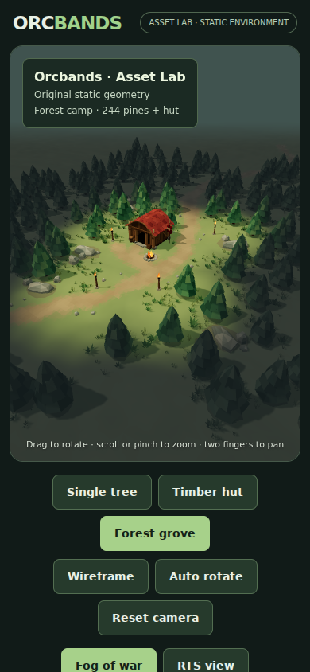
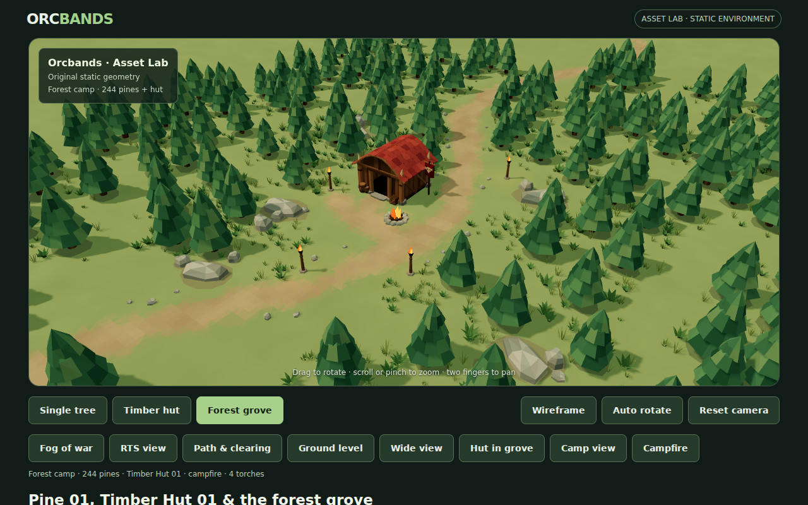

# Trail torches and fog of war

Four original timber-and-iron torches mark the camp's foot trails. Each has a buried stone footing, tapered stake, bindings, open flared basket and three faceted, animated flame meshes. Static parts are merged by material; flame geometry reuses the campfire's authored construction. Each torch has a bounded, flickering point light without dynamic shadows.

## Actual WebGL review













These are actual Chromium WebGL captures. Owner review found the first fog pass too strong. The updated pass widens the feathered edge, preserves dim woodland detail outside the reveal sources and uses a softer green-grey horizon. The closer default/RTS camera keeps the inhabited clearing readable.

## Visibility

`preview/camp-visibility.js` defines a union of six reveal sources: the hut (10.5 metre radius), campfire (5 metres), and four torches (6.2 metres each). The soft transition now spans 8 metres: 3 metres inside each radius and another 5 metres into the surrounding woods. Overlaps remain clear, rather than stacking darkness. A small spatial ripple breaks up mathematically perfect boundary circles. The reveal area stays fixed as the flames flicker so the fog does not pulse distractingly.

A small material shader extension darkens the actual geometry by its horizontal distance to these sources. It works with instanced trees and the terrain, without a screen overlay or extra rendering pass. It follows the grove during auto rotation. Distant woodland keeps muted, desaturated detail under a cool green mist; the camp remains in the existing daylight palette. The mask dims the underlying lighting and blends in a restrained mist tint instead of replacing it with near-black. A matching green-grey horizon avoids a hard black backdrop. This is stylized visibility, not physical nighttime illumination.

**Fog of war** starts enabled in the grove. Its button reveals the whole forest when disabled. Single Tree and Timber Hut studio modes disable the mask and preserve their existing lighting and controls.

`preview/environment-layout.js` owns deterministic torch locations and keeps grass/loose rocks away from their footings. Every stake is beside a path and at least two metres from a trunk. Tree placements, Pine 01 and Timber Hut 01 source assets and generators are untouched. The small clearance adjustment leaves 1,615 grass clumps, with 244 pines and 38 rocks.

## Scope and performance

This is the camp's initial, static fog-of-war presentation. There are no units, visibility blockers, explored-area memory or discovery simulation. Future moving reveal sources can use the same distance-mask approach; this implementation currently compiles the fixed source count. Concealed trees still render, so fog is not a culling optimization.

Four extra shadowless point lights add fragment-lighting work. Captured scene counters are 53–59 draw calls and approximately 177,200 triangles, depending on camera culling; hut studio remains 21 calls / 3,146 triangles. Fog adds no geometry or draw calls. The conservative smoke budget is 66 calls / 182,000 triangles. Real mobile hardware FPS remains unmeasured; portrait WebGL and touch controls are exercised in Chromium. No new dependencies or external assets.

## Verification

`tools/validate-camp-visibility.mjs` checks source centres, distant concealment, smooth falloff, path/tree/prop clearance, reproducible torch geometry and animation, bounded lights, instanced shader injection, toggle state and rotation coordinates. Existing tree, hut, campfire and terrain validation remain intact.

The browser smoke captures elevated, path, low, wide, camp, hearth and portrait views, plus the full forest with fog off. It checks torch animation, default reveal sources, toggle state, studio isolation, deterministic reload, desktop orbit/zoom/pan/reset, mobile touch controls and browser errors. CI retains automatic screenshot artifacts.

```sh
node tools/validate-environment.mjs
node tools/validate-hut.mjs
node tools/validate-campfire.mjs
node tools/validate-camp-visibility.mjs
ORCBANDS_LOCAL_THREE=1 node tools/smoke-preview.mjs
```
