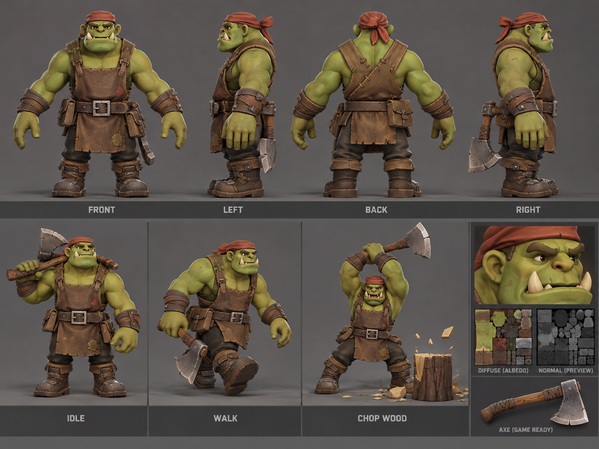
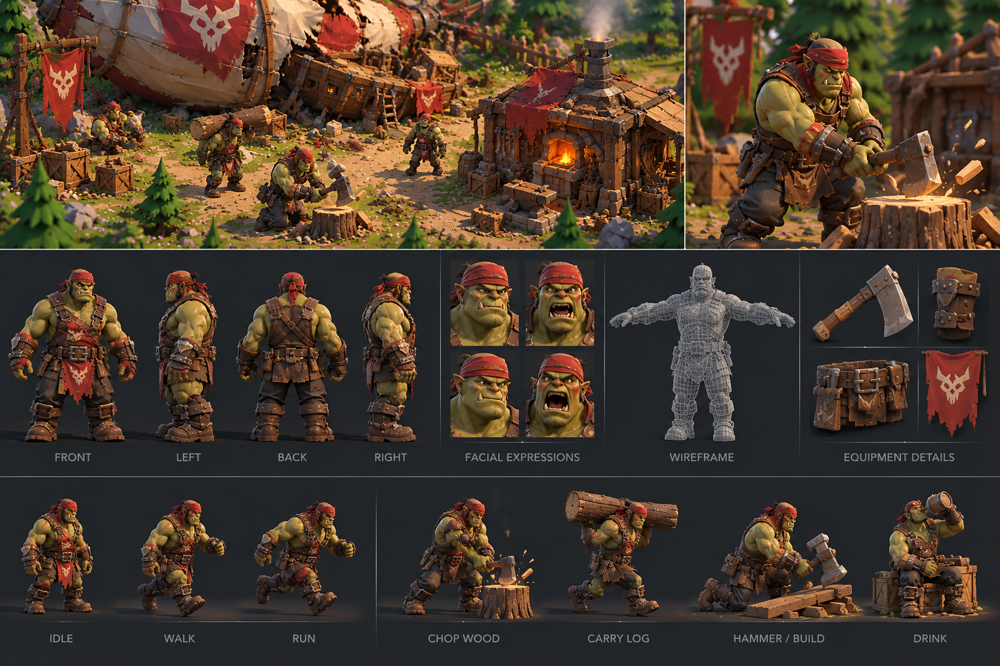
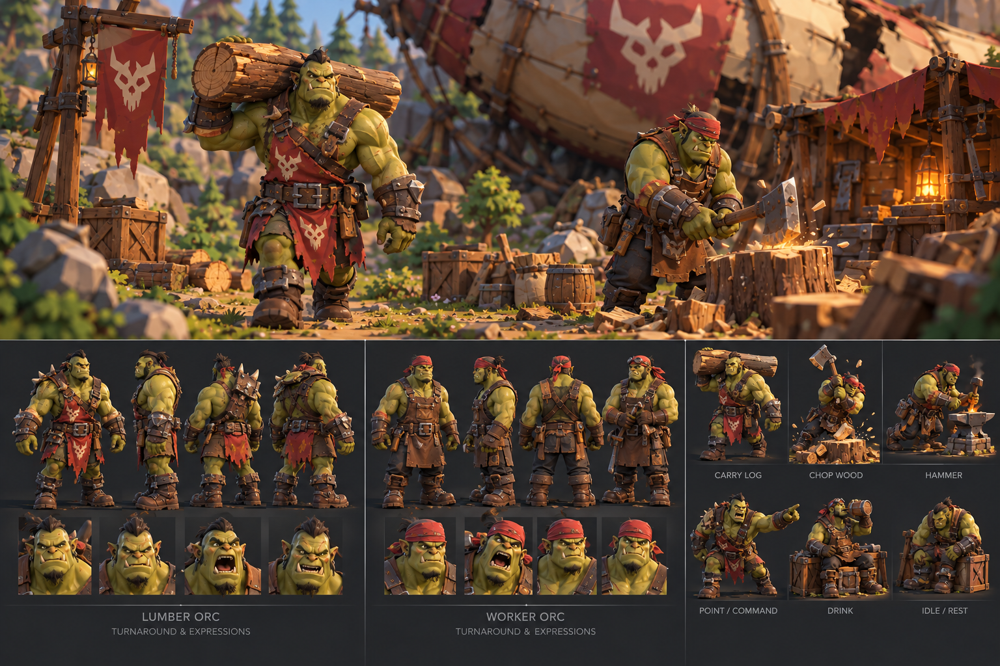

# Worker Orc: sculpt and production brief

Issue: [#15](https://github.com/cubitouch/Orcbands/issues/15).
Status: **reference recovery and production handoff only; no new character delivered.**
Base inspected: `0b09b37` (main on 2026-10-17).

## Decision

Build an original, artist-directed sculpt from the primary turnaround. Approve
its unrigged silhouette and face before retopology, texture polish or animation.
Do not commission another variation of `worker_orc_vnext.py`'s primitive assembly.
Its ring lofts, separate facial overlays and procedural colors are useful
prototypes, but are not a demonstrated route to the reference's finish.

The agent session inspected all three supplied PNGs and the current source.
It did not produce a replacement sculpt, Blender renders, an exported-model
baseline comparison, or new Chromium captures. Blender was not installed in
that session. This is not evidence that scripted modeling is impossible; it is
an explicit limit on what this handoff demonstrates. The original issue stays
open. Existing CI results must not be represented as candidate art acceptance.

## Source of truth

Use the full-resolution files, not the embedded thumbnails alone:

1. [Primary worker turnaround](../art/references/worker-orc/01-worker-turnaround.png)
2. [Artisan showcase](../art/references/worker-orc/02-artisan-showcase.png)
3. [Village context](../art/references/worker-orc/03-village-context.png)

The separate environment sheet named in #15 was not supplied. Do not invent it.
The village portions of references 2 and 3 provide useful context already.
These are AI concept illustrations: pictured wireframes and texture thumbnails
are not usable geometry, topology evidence or production texture atlases.

Reference priority resolves contradictions: use the primary sheet's brown apron,
red headscarf and dark trousers. The secondary sheet's red tabard, crest and
heavier armor are not required. Do not combine every decorative element.

## Ranked visual requirements

| Priority | Area | Specific target | Review test |
| --- | --- | --- | --- |
| 1 | Silhouette | Broad trapezius and shoulders, deep chest, compact legs; distinct forearm taper, large useful hands and planted boots | Front/profile/back clay turntable and 160–220 px character-height RTS view |
| 1 | Face | Wide squared lower jaw, projecting muzzle, compressed brow over recessed eyes, broad nose with actual nostrils, integrated cheek planes | Neutral-lit face close-up; preserve eye sockets and mouth silhouette without painted shadows |
| 1 | Expression | Focused, slightly gruff worker; readable small eyes and heavy eyebrows, closed relaxed mouth with upward lower tusks | Front and three-quarter eye-level views; avoid spherical cheeks and detached brow strips |
| 1 | Anatomy | Continuous neck/torso/shoulder/arm skin with deliberate muscle planes and believable elbow transitions | Clay side views and later overhead shoulder test; no floating parts or overlapping skin shells |
| 2 | Hands | Thumb opposition, four separated fingers, knuckles and palms; sufficient volume to grip a cylindrical haft | Palm/back close-ups and actual closed axe grip, not fingertips hovering near handle |
| 2 | Clothing | Fitted brown bib/apron with thickness, crossed back straps, belt tension, irregular worn hem and a few patches | Side/back views must show how straps join and how belt supports pouches |
| 2 | Boots | Broad grounded soles, distinct toe/heel, layered leather shafts and functional straps | Profile and underside; no spherical feet or straps cutting through ankle |
| 2 | Axe and gear | Wooden haft, wrapped grip, heavy wedge-shaped iron blade, attached belt pouches | Handle seated in axe head; attachment hardware and axe grip readable |
| 3 | Skin | Olive/yellow-green local variation around face, joints and fingers; broad stylized shading | Albedo under neutral light; avoid baked hard directional shadows |
| 3 | Leather/cloth | Brown hide with restrained grain, edge wear and seams; red woven headscarf with folds/knot | Different roughness response; detail must support form rather than add uniform noise |
| 3 | Metal | Forged dark iron with selective polished edges; ivory tusks remain nonmetallic | Exported material response across a light rotation |
| 3 | Pose | Relaxed weight-bearing stance with hands clear of torso; axe removable for rigging | Feet on ground, sensible center of mass, readable from RTS camera |

Tiny stitches are lower priority than face, connected anatomy and garment fit.
The primary sheet has inconsistent anatomy and equipment across poses; choose
one coherent construction and document deviations rather than reproducing errors.

## Production stages and stop gates

### A. Baseline capture before sculpt evaluation

Freeze the currently deployed `asset-build.json`, source SHA and SHA-256 of both
released GLBs. Capture the exported rigged GLB in its neutral/idle pose and use
that exact file for all comparisons. Do not regenerate a baseline and call it
the exact released asset without checking hashes.

Use identical orthographic scale, character height, ground plane, exposure,
neutral background and lights. Capture front, both profiles, back, three-quarter,
face, hands/gear and a five-character RTS layout. Record camera transforms,
projection, viewport, light settings and animation time alongside screenshots.
The face framing may differ from the full-body framing but must match across
baseline and candidate. Keep a neutral-lit set separate from presentation renders.

### B. Static sculpt — approval before production conversion

A character artist builds a connected organic body and head with hand-directed
planes, then fitted clothing and separate rigid props. Use symmetry for major
forms, deliberate asymmetry for expression, folds and wear. Review gray clay
first, then flat material colors. Deliver an editable `.blend` with named body,
clothing and equipment collections. No rigging spend until the owner can
immediately see a substantial improvement in the face and RTS silhouette.

If the first major sculpt review still resembles an assembly of inflated parts,
stop and revise the sculpt workflow or artist assignment. Do not compensate
with more triangles, lighting or animation.

### C. Retopology, UVs and textures

Retopologize for shoulder elevation, elbow/knee bends, jaw and finger movement;
preserve continuous exposed skin. Separate garments are appropriate, detached
anatomy is not. Keep editable sculpt and retopology in the source file. Define
UV seams away from face and exposed shoulder fronts; review texel density and
padding at the actual mip levels. Bake high-to-low normal detail with an
inspected cage; inspect seams and inverted/tangent artifacts in the GLB viewer.

Author portable base-color, roughness/metallic and normal images. Export glTF
compatible materials: base color in sRGB, normal and roughness/metallic data in
linear space, glTF channel packing. Inspect the actual exported GLB; Blender
procedural nodes alone do not prove portable texture delivery. Avoid alpha on
opaque skin/clothes; use geometry for major torn hems.

Provisional starting budgets, **not measured results or acceptance by count**:
30–60k triangles including equipment; 2–4 material slots; one 2K body atlas and
one 2K clothing/gear atlas, with base-color, packed material and normal maps.
Six uncompressed 2K RGBA maps are approximately 96 MiB before mipmaps and 128 MiB
with a complete mip chain; measure actual GPU allocation and reduce/pack/compress
as needed. Five instances should share geometry and textures. Record GLB bytes,
triangles, draw calls, texture dimensions and actual viewer frame times.

### D. Export review, then rig

Compare actual Blender renders and Chromium WebGL screenshots for texture
placement, normals, alpha and color. A browser-only lighting difference must be
distinguished from an export defect. Test five instances on a named desktop
machine at a recorded resolution with the same scene for baseline and candidate;
report median/p95 frame time after warm-up and load time. A proposed target is
60 fps at 1080p on the agreed desktop, subject to measurement and owner approval.

Only after static approval, build/adjust the deforming humanoid skeleton and
weights. Review shoulder elevation, elbow flexion, neck turn, deep knee bend and
closed grip. Deliver Idle, Walk, Chop and Carry with a real carried log. Inspect
foot sliding, two-hand axe alignment and garment penetration. Unity Humanoid
status stays **unverified** until an actual Unity import/Avatar/retargeting test.

## Delivery and evidence contract

- Editable `.blend` (sculpt + retopology), final GLB, source texture images and
  export settings/version. Preserve external dependencies or pack them explicitly.
- Provenance ledger for every input; license texts and required attribution.
- Exact candidate source commit and output SHA-256 hashes.
- Full-resolution actual-model multi-angle images from stage A; neutral matched
  baseline/candidate pairs, five-character RTS scene, and Blender/WebGL pairs.
- After rigging, idle, walk extrema, overhead chop, loaded carry and deformation
  extremes. Keep static and rigged approvals distinct.
- Browsable CI artifact index and manifest containing cameras, lighting, render
  engine/version, dimensions, source/output hashes and measured budgets.
- Candidate-only branch/preview with `Current baseline` and `Candidate` clearly
  labeled. Keep live main's asset until the owner approves the visual stage.

No generated illustration may be placed in the actual-model evidence directory.
CI green validates structure and execution, not artistic quality. An anonymous
A/B review at full body and RTS distance should precede approval; record the
owner's choice and remaining defects rather than claiming an objective score.

## Rights and feasible resourcing

Recommended route: commission an **original sculpt**, using these owner-supplied
concepts as art direction, with agreed permission to modify, commercially use
and redistribute the delivered source, textures and exports in this public
repository. Confirm those terms in writing before accepting external work.
Reference provenance is recorded separately; no blanket CC0 grant is invented.

No third-party base is selected or license-verified by this handoff. An optional
artist-proposed base must be reviewed before use: record source URL, creator,
exact license/version, modification permission, attribution, and permission to
redistribute editable meshes/textures publicly. A game-use license alone is
insufficient for committing source assets. Do not purchase or import a base
without owner authorization. The earlier simplified goblin is not the default.

Planning estimate for one experienced stylized character artist, **not a quote**:

| Stage | Estimated working days | Checkpoint |
| --- | --- | --- |
| Reference reconciliation and blockout | 1–2 | Silhouette/proportions |
| Face/body sculpt and fitted outfit/props | 4–7 | Static sculpt approval |
| Retopology, UVs, bake and textures | 4–6 | Exported static model approval |
| Rig, weights and four animation clips | 3–5 | Deformation/motion review |
| Export parity, performance and revisions | 2–4 | Candidate acceptance |
| Total | 14–24 | Approximately 3–5 working weeks, excluding review delays |

Request a fixed first milestone for blockout plus a face/torso sculpt review,
then commission the remaining stages after visual acceptance. Cost should be
quoted from this scope and rights requirement; no market rate has been verified.
The owner does not need to install Unity for the static milestone: Blender source,
GLB browser preview and captured evidence are sufficient until Unity validation.

## Outstanding acceptance

References are now versioned on this branch. **All model-quality, exported GLB
parity, comparative render, performance and rig acceptance remains pending.**
This document is the concrete artist-workflow fallback requested in #15, not
completion of the visual overhaul. Do not close #15 when merging this handoff.
